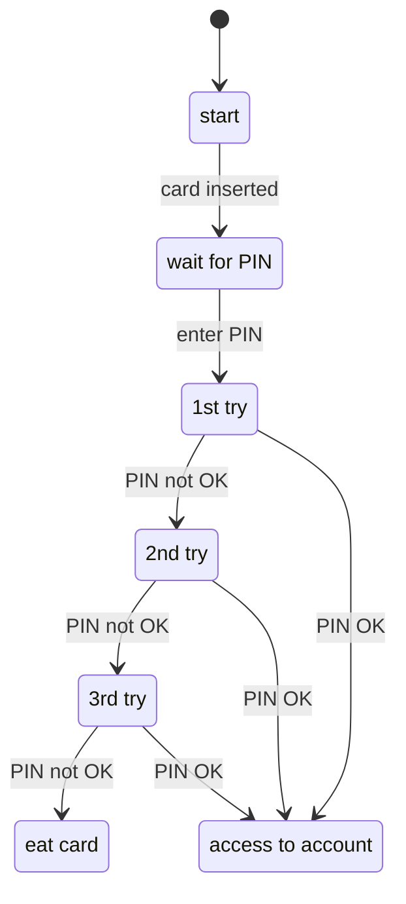
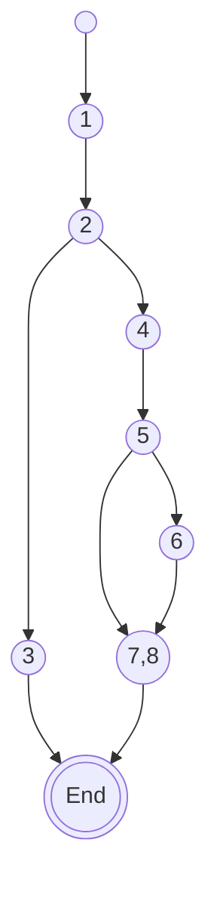
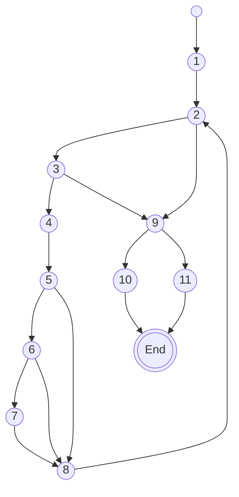
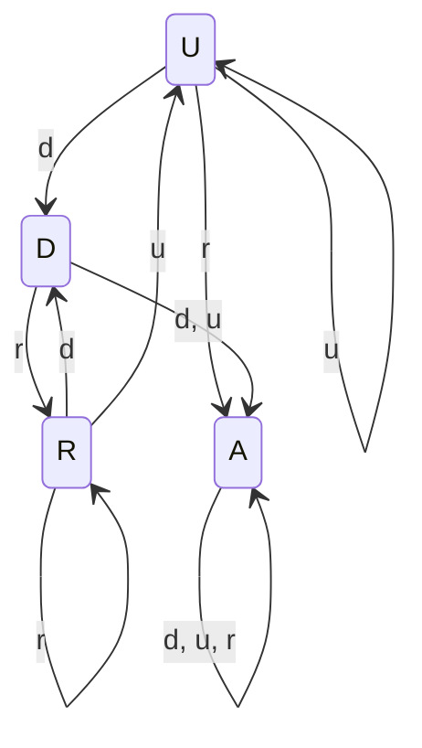
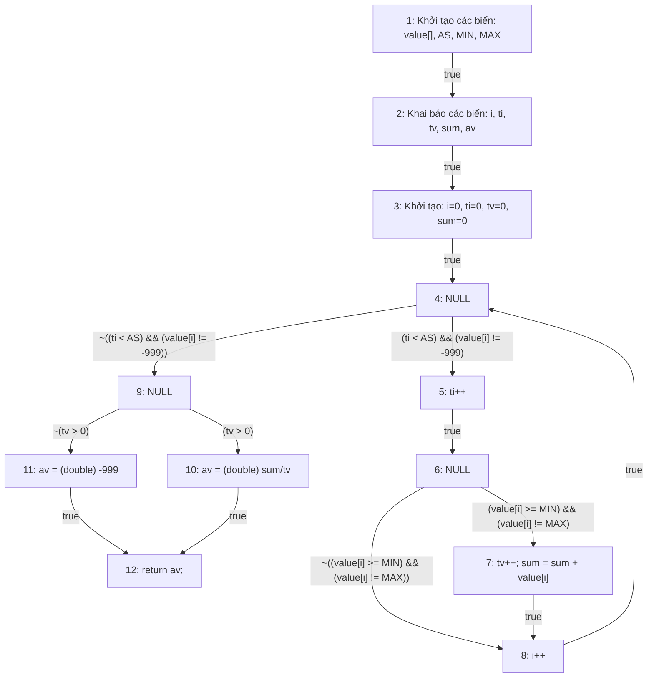
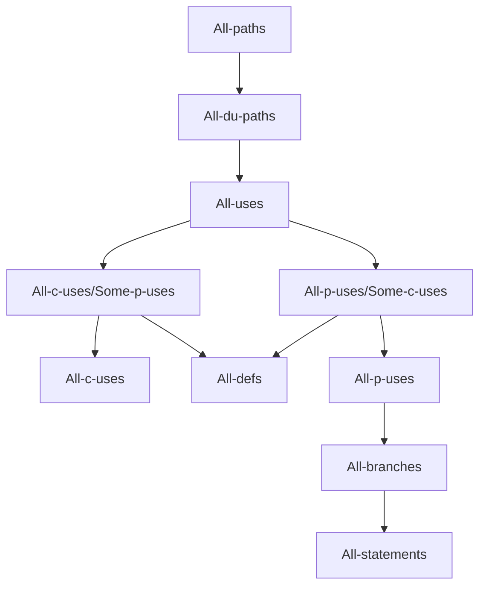
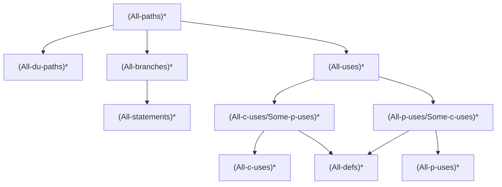
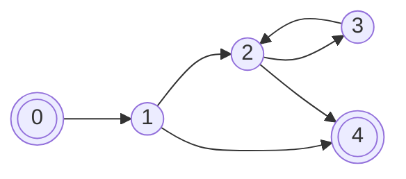

# KIỂM THỬ VÀ ĐẢM BẢO CHẤT LƯỢNG PHẦN MỀM

## Chương 4: CÁC KỸ THUẬT KIỂM THỬ

**Giảng viên:** Nguyễn Thị Phương Dung

---

## Mục lục

1. [Tổng quan các kỹ thuật kiểm thử](#1-tổng-quan-các-kỹ-thuật-kiểm-thử)
2. [Kỹ thuật kiểm thử hộp đen](#2-kỹ-thuật-kiểm-thử-hộp-đen)
   - 2.1 Phân vùng tương đương
   - 2.2 Phân tích giá trị biên
   - 2.3 Kiểm thử bằng bảng quyết định
   - 2.4 Kiểm thử bằng sơ đồ chuyển trạng thái
3. [Kỹ thuật kiểm thử hộp trắng](#3-kỹ-thuật-kiểm-thử-hộp-trắng)
   - 3.1 Kiểm thử dòng điều khiển
   - 3.2 Kiểm thử dòng dữ liệu

---

## 1. Tổng quan các kỹ thuật kiểm thử

- Mục đích của kỹ thuật kiểm thử là xác định **điều kiện kiểm thử**, **trường hợp kiểm thử** và **dữ liệu** dùng để kiểm thử.
- Các loại kỹ thuật kiểm thử:
  - Kiểm thử hộp đen
  - Kiểm thử hộp trắng
  - Kiểm thử theo kinh nghiệm

### Các yếu tố ảnh hưởng đến việc lựa chọn kỹ thuật

Việc lựa chọn kỹ thuật kiểm thử nào phụ thuộc vào các yếu tố sau:

- Độ phức tạp của thành phần hoặc hệ thống
- Tiêu chuẩn quy định, độ an toàn
- Yêu cầu của khách hàng hoặc hợp đồng
- Mức độ và loại rủi ro
- Tài liệu có sẵn
- Kiến thức và kỹ năng của người kiểm thử
- Công cụ có sẵn
- Thời gian và ngân sách
- Mô hình vòng đời phát triển phần mềm
- Các loại lỗi dự kiến trong thành phần hoặc hệ thống

> Có thể **kết hợp** các kỹ thuật kiểm thử để có được kết quả thử nghiệm tốt.

### Đặc điểm các loại kỹ thuật kiểm thử

**Kỹ thuật kiểm thử hộp đen** (còn gọi là *kỹ thuật kiểm thử hành vi*):

- Dựa trên một phân tích cơ sở thử nghiệm thích hợp.
- Có thể áp dụng cho cả thử nghiệm chức năng và không chức năng.
- Tập trung vào các **đầu vào và đầu ra** của đối tượng kiểm tra mà không cần tham chiếu đến cấu trúc bên trong của nó.

**Kỹ thuật kiểm thử hộp trắng** (còn gọi là *kỹ thuật kiểm thử cấu trúc*):

- Dựa trên một phân tích của kiến trúc, thiết kế chi tiết, cấu trúc bên trong hoặc mã của đối tượng thử nghiệm.
- Không giống như hộp đen, kiểm thử hộp trắng tập trung vào **cấu trúc và xử lý bên trong** đối tượng kiểm thử.

**Kỹ thuật kiểm thử dựa trên kinh nghiệm:**

- Tận dụng kinh nghiệm của nhà phát triển, người kiểm tra và người dùng để thiết kế, triển khai và thực hiện các bài kiểm tra.
- Thường được kết hợp với kỹ thuật kiểm tra hộp đen và hộp trắng.

### Các đặc điểm chung

**Kỹ thuật kiểm thử hộp đen:**

- Các điều kiện kiểm thử, trường hợp kiểm thử và dữ liệu kiểm thử được lấy từ cơ sở kiểm thử, có thể bao gồm yêu cầu phần mềm, thông số kỹ thuật, trường hợp sử dụng và thói quen của người dùng.
- Các trường hợp kiểm thử có thể được sử dụng để phát hiện khoảng cách giữa các yêu cầu và việc thực hiện yêu cầu, cũng như sai lệch so với yêu cầu.
- Mức độ phù hợp được đo lường dựa trên các hạng mục được kiểm tra trong cơ sở thử nghiệm và kỹ thuật áp dụng cho cơ sở thử nghiệm.

**Kỹ thuật kiểm thử hộp trắng:**

- Điều kiện kiểm thử, trường hợp kiểm thử và dữ liệu kiểm thử được lấy từ cơ sở kiểm tra, có thể bao gồm mã, kiến trúc phần mềm, thiết kế chi tiết hoặc bất kỳ nguồn thông tin nào khác liên quan đến cấu trúc của phần mềm.
- Mức độ phù hợp được đo lường dựa trên các mục được kiểm tra trong một cấu trúc đã chọn (ví dụ: mã hoặc giao diện) và kỹ thuật áp dụng cho cơ sở thử nghiệm.

**Kỹ thuật kiểm thử dựa trên kinh nghiệm:**

- Điều kiện kiểm thử, trường hợp kiểm thử và dữ liệu kiểm thử được lấy từ cơ sở kiểm thử, có thể bao gồm kiến thức và kinh nghiệm của người kiểm thử, nhà phát triển, người dùng và các bên liên quan khác.
- Kiến thức và kinh nghiệm này bao gồm việc sử dụng dự kiến phần mềm, môi trường của nó, các khiếm khuyết có thể xảy ra, và sự phân bố của những khiếm khuyết đó.
- Tiêu chuẩn quốc tế **ISO/IEC/IEEE 29119-4** bao gồm các mô tả về kỹ thuật thử nghiệm và các biện pháp bao phủ tương ứng.

---

## 2. Kỹ thuật kiểm thử hộp đen

### Các phương pháp xây dựng ca kiểm thử

- Phương pháp phân vùng tương đương (kiểm thử lớp tương đương)
- Phương pháp phân tích giá trị biên (kiểm thử giá trị biên)
- Phương pháp sử dụng bảng quyết định (kiểm thử bằng bảng quyết định)
- Phương pháp sử dụng sơ đồ chuyển trạng thái (kiểm thử chuyển trạng thái)

---

### 2.1 Phân vùng tương đương

- Là cách chia dữ liệu đầu vào thành các **vùng tương đương** sao cho các giá trị trong mỗi phần có tác động tương tự với chương trình.
- Mỗi vùng cần chọn ra một giá trị đại diện bất kỳ để xây dựng bộ kiểm thử.
- Các vùng tương đương được phân cho cả giá trị hợp lệ và giá trị không hợp lệ:
  - **Giá trị hợp lệ** là giá trị được thành phần hoặc hệ thống chấp nhận. Một phân vùng tương đương chứa các giá trị hợp lệ được gọi là *"phân vùng tương đương hợp lệ"*.
  - **Giá trị không hợp lệ** là các giá trị bị thành phần hoặc hệ thống từ chối. Một phân vùng tương đương chứa các giá trị không hợp lệ được gọi là *"phân vùng tương đương không hợp lệ"*.

#### Xác định vùng tương đương

- Phân tích mã nguồn của chương trình
- Dựa vào hiểu biết về chức năng của chương trình

**Ví dụ:** A là một số nguyên trong khoảng từ 1 đến 200.

- Miền hợp lệ là các giá trị từ 1 đến 200.
- Miền không hợp lệ bao gồm 4 miền:
  - Miền không hợp lệ 1: miền dữ liệu không phải là số
  - Miền không hợp lệ 2: các giá trị số < 1
  - Miền không hợp lệ 3: các giá trị số > 200
  - Miền không hợp lệ 4: các giá trị không phải là số nguyên

#### Xác định số ca kiểm thử trong kiểm thử lớp tương đương

**Phân loại:**

- **Lớp tương đương yếu:**
  - Mỗi không gian tương đương có ít nhất một phần tử xuất hiện trong một ca kiểm thử nào đó.
  - Số ca kiểm thử tối thiểu = số lớp tương đương lớn nhất của các miền đầu vào.
- **Lớp tương đương mạnh:**
  - Số ca kiểm thử = tổ hợp có thể của các miền tương đương.

**Ví dụ:**

- Chương trình cần 3 biến đầu vào a, b, c tương ứng với không gian đầu vào là A, B, C.
- Giả sử miền tương đương cho mỗi không gian đầu vào là:
  - A = A1 ∪ A2 ∪ A3
  - B = B1 ∪ B2 ∪ B3 ∪ B4
  - C = C1 ∪ C2
- Ký hiệu phần tử của các miền tương đương bằng chữ thường với cùng chỉ số trong các miền tương ứng.

Số ca kiểm thử theo **lớp tương đương yếu** (= 4, bằng số lớp lớn nhất là B):

| TT | a  | b  | c  |
|----|----|----|----|
| 1  | a1 | b1 | c1 |
| 2  | a2 | b2 | c2 |
| 3  | a3 | b3 | c1 |
| 4  | a1 | b4 | c2 |

Số ca kiểm thử theo **lớp tương đương mạnh** = 3 × 4 × 2 = **24 ca**:

| TT | a  | b  | c  |
|----|----|----|----|
| 1  | a1 | b1 | c1 |
| 2  | a1 | b1 | c2 |
| 3  | a1 | b2 | c1 |
| 4  | a1 | b2 | c2 |
| 5  | a1 | b3 | c1 |
| 6  | a1 | b3 | c2 |
| 7  | a1 | b4 | c1 |
| 8  | a1 | b4 | c2 |
| …  | …  | …  | …  |
| 24 | a3 | b4 | c2 |

#### Bài tập

1. Áp dụng phương pháp phân vùng tương đương, xác định số ca kiểm thử cho chương trình giải phương trình bậc nhất.
2. Áp dụng phương pháp phân vùng tương đương, xác định số ca kiểm thử cho chương trình giải phương trình bậc 2.

---

### 2.2 Phân tích giá trị biên

Xét hàm `y = f(x1, x2)` với điều kiện:

- x1, x2, y ∈ N
- a < x1 < b
- c < x2 < d
- a, b, c, d là các hằng số

*(Hình: miền xác định là hình chữ nhật giới hạn bởi a ≤ x1 ≤ b và c ≤ x2 ≤ d trên hệ trục x1, x2.)*

Vấn đề dễ xảy ra lỗi khi lập trình viên không kiểm tra khoảng giá trị hợp lệ của dữ liệu đầu vào. Ví dụ: `a < x1` hay `a <= x1`.

#### Kiểm thử giá trị biên

Xác định số ca kiểm thử cho mỗi biến là các giá trị:

- cực đại (**max**)
- cực tiểu (**min**)
- giá trị cạnh cực đại trong miền xác định (**max-**)
- giá trị cạnh cực tiểu trong miền xác định (**min+**)
- giá trị ở giữa miền xác định đại diện cho giá trị thông thường (**nom**)

#### Xác định số ca kiểm thử

| TT | X1       | X2       |
|----|----------|----------|
| 1  | x1 (nom) | x2 (nom) |
| 2  | x1 (min) | x2 (nom) |
| 3  | x1 (min+)| x2 (nom) |
| 4  | x1 (max-)| x2 (nom) |
| 5  | x1 (max) | x2 (nom) |
| 6  | x1 (nom) | x2 (min) |
| 7  | x1 (nom) | x2 (min+)|
| 8  | x1 (nom) | x2 (max-)|
| 9  | x1 (nom) | x2 (max) |

- Tổng số ca kiểm thử giá trị biên của hàm **n biến** sẽ là **4n** *(theo slide)*.

> **Ghi chú của người chuyển đổi:** Bảng trên có 9 ca với n = 2, tức `4n + 1` (đã tính thêm ca nom–nom). Công thức `4n` trên slide chưa tính ca này (tương tự `6n` ở phần giá trị biên mạnh, thường là `6n + 1`).
- Tùy theo miền xác định của biến mà số lượng ca kiểm thử có thể ít hơn. Ví dụ: biến kiểu Boolean chỉ có 2 giá trị true/false ⇒ không có các giá trị cận biên và ở giữa.

#### Kiểm thử giá trị biên mạnh

- Bổ sung các giá trị cận biên **bên ngoài** miền xác định.
- Giúp kiểm tra xem chương trình có xử lý ngoại lệ hay không.
- Số ca kiểm thử trong trường hợp này là: **6n** *(theo slide)*.

#### Kiểm thử giá trị biên tổ hợp

Mỗi biến đầu vào đều thực hiện kiểm thử với tất cả các giá trị biên, cận biên và giá trị thông thường thì hàm n biến sẽ có:

- Số ca kiểm thử đối với các giá trị trong miền xác định là: **5n** *(theo slide)*
- Số ca kiểm thử đối với các giá trị trong cả miền xác định và miền không xác định là: **7n** *(theo slide)*

> **Ghi chú của người chuyển đổi:** Slide ghi `5*n` và `7*n`, nhưng nếu tổ hợp tất cả các giá trị của mọi biến với nhau thì số ca thường được tính là **5ⁿ** và **7ⁿ** (lũy thừa). Nên đối chiếu lại với giáo trình/giảng viên.

#### Kiểm thử các giá trị đặc biệt

- Dựa trên hiểu biết về bài toán, miền ứng dụng kết hợp với kinh nghiệm cá nhân để đưa ra các giá trị kiểm thử.
- Mức độ hiệu quả phụ thuộc vào khả năng của người kiểm thử.

#### Ưu nhược điểm của kiểm thử giá trị biên

- **Ưu điểm:**
  - Phù hợp khi xét các giá trị biến độc lập.
- **Nhược điểm:**
  - Khó thực hiện khi các biến có quan hệ phụ thuộc.
  - Không quan tâm đến tính chất, đặc trưng của hàm.
  - Không xét đến ngữ nghĩa của biến.

#### Bài tập

1. Áp dụng phương pháp phân tích giá trị biên, xác định số ca kiểm thử cho chương trình nhập vào 3 số, xác định 3 số đó có là một ngày tháng hợp lệ hay không?
2. Áp dụng phương pháp phân tích giá trị biên, xác định số ca kiểm thử cho chương trình nhập vào 3 số, xác định 3 số đấy có phải là 3 cạnh tam giác hay không, nếu đúng thì thuộc loại tam giác gì?

---

### 2.3 Kiểm thử bằng bảng quyết định

- Sử dụng bảng để mô tả các sự kiện, hành vi sẽ xảy ra khi một số điều kiện thỏa mãn.
- Cấu trúc bảng bao gồm 4 thành phần:
  - Các biểu thức điều kiện C1, C2, C3, … tương ứng với các biến hoặc các biểu thức quan hệ.
  - Giá trị điều kiện:
    - `T`, `F`, `–` (đối với bảng quyết định logic)
    - Các giá trị cụ thể (đối với bảng quyết định tổng quát)
  - Các hành động A1, A2, A3, A4, … tương ứng với một thủ tục hoặc thao tác cần thực hiện.
  - Giá trị hành động: có (xảy ra) hay không, `X` là có.

**Ví dụ cấu trúc bảng quyết định:**

|              |    | Quy tắc 1 | 2 | 3 | 4 | 5 | 6 |
|--------------|----|:---:|:---:|:---:|:---:|:---:|:---:|
| **Điều kiện**| C1 | T | T | T | F | F | F |
|              | C2 | T | T | F | T | F | F |
|              | C3 | T | F | – | – | T | F |
| **Hành động**| A1 | X | X |   | X |   |   |
|              | A2 | X |   |   |   | X |   |
|              | A3 |   | X |   | X | X |   |
|              | A4 |   |   | X |   |   | X |

**Ví dụ: Khắc phục sự cố máy in**

| | | 1 | 2 | 3 | 4 | 5 | 6 | 7 | 8 |
|---|---|:-:|:-:|:-:|:-:|:-:|:-:|:-:|:-:|
| **Điều kiện** | Máy in không in | Y | Y | Y | Y | N | N | N | N |
| | Đèn đỏ nhấp nháy | Y | Y | N | N | Y | Y | N | N |
| | Không nhận ra máy in | Y | N | Y | N | Y | N | Y | N |
| **Hành động** | Kiểm tra dây nguồn | | | X | | | | | |
| | Kiểm tra dây tín hiệu | X | | X | | | | | |
| | Kiểm tra phần mềm in đã cài đúng | X | | X | | X | | X | |
| | Kiểm tra/thay mực | X | X | | | X | X | | |
| | Kiểm tra kẹt giấy | | X | | X | | | | |

#### Thiết kế ca kiểm thử

- Để xác định ca kiểm thử, cần chuyển các điều kiện thành đầu vào, hành động thành đầu ra.
- Một số điều kiện sẽ tham chiếu đến các lớp tương đương đầu vào, và hành động tham chiếu đến các phần xử lý chức năng chính của cột đang xét.
- **Số quy tắc chính là số các ca kiểm thử.**

#### Sử dụng bảng quyết định

Bảng thích hợp khi:

- Đặc tả có thể chuyển về dạng bảng.
- Thứ tự các hành động xảy ra không quan trọng.
- Thứ tự các luật không ảnh hưởng đến hành động.
- Giảm số ca kiểm thử khi có luật quyết định thỏa mãn.

**Chú ý:** Trước khi sử dụng bảng cần đảm bảo:

- Các luật phải **đầy đủ**: có mọi tổ hợp.
- Các luật phải **nhất quán**: mọi tổ hợp giá trị chân lý chỉ gây ra một hoặc một tập hành động.

#### Bài tập

Sử dụng bảng quyết định để xây dựng các ca kiểm thử cho bài toán nhập 3 cạnh, kết luận 3 cạnh đó có là 3 cạnh của tam giác hay không? Nếu đúng thì đó là tam giác gì?

#### Bảng quyết định cho bài toán tam giác

| | | 1 | 2 | 3 | 4 | 5 | 6 | 7 | 8 | 9 | 10 | 11 |
|---|---|:-:|:-:|:-:|:-:|:-:|:-:|:-:|:-:|:-:|:-:|:-:|
| **Điều kiện** | C1: a < b+c? | F | T | T | T | T | T | T | T | T | T | T |
| | C2: b < a+c? | – | F | T | T | T | T | T | T | T | T | T |
| | C3: c < a+b? | – | – | F | T | T | T | T | T | T | T | T |
| | C4: a=b? | – | – | – | T | T | T | T | F | F | F | F |
| | C5: a=c? | – | – | – | T | T | F | F | T | T | F | F |
| | C6: b=c? | – | – | – | T | F | T | F | T | F | T | F |
| **Hành động** | A1: Không phải là tam giác | X | X | X | | | | | | | | |
| | A2: Tam giác thường | | | | | | | | | | | X |
| | A3: Tam giác cân | | | | | | | X | | X | X | |
| | A4: Tam giác đều | | | | X | | | | | | | |
| | A5: Không hợp lệ | | | | | X | X | | X | | | |

#### Ca kiểm thử cụ thể cho bài toán tam giác

| TT | a | b | c | Kết quả mong đợi |
|---:|:-:|:-:|:-:|------------------|
| 1  | 4 | 1 | 2 | Không phải tam giác |
| 2  | 1 | 4 | 2 | Không phải tam giác |
| 3  | 1 | 2 | 4 | Không phải tam giác |
| 4  | 5 | 5 | 5 | Tam giác đều |
| 5  | ? | ? | ? | Không khả thi |
| 6  | ? | ? | ? | Không khả thi |
| 7  | 2 | 2 | 3 | Tam giác cân |
| 8  | ? | ? | ? | Không khả thi |
| 9  | 2 | 3 | 2 | Tam giác cân |
| 10 | 3 | 2 | 2 | Tam giác cân |
| 11 | 3 | 4 | 5 | Tam giác thường |

---

### 2.4 Kiểm thử bằng sơ đồ chuyển trạng thái

- Thử nghiệm chuyển đổi trạng thái được sử dụng khi một số khía cạnh của hệ thống có thể được mô tả theo hình thức **"máy trạng thái hữu hạn"**, tức hệ thống có thể ở một số hữu hạn các trạng thái khác nhau.
- Việc kiểm thử sẽ thực hiện các trường hợp dữ liệu có thể để đi qua tất cả các trạng thái của máy.

**Ví dụ: sơ đồ chuyển trạng thái của việc nhập mã PIN**



#### Bài tập

1. Áp dụng các phương pháp xây dựng ca kiểm thử, xác định số ca kiểm thử cho chương trình nhập vào 3 số, xác định 3 số đó có là một ngày tháng hợp lệ hay không?
2. Áp dụng các phương pháp xây dựng ca kiểm thử, xác định số ca kiểm thử cho chương trình nhập vào 3 số, xác định 3 số đấy có phải là 3 cạnh tam giác hay không, nếu đúng thì thuộc loại tam giác gì?

---

## 3. Kỹ thuật kiểm thử hộp trắng

### Các phương pháp xây dựng ca kiểm thử

- Phương pháp kiểm thử dòng điều khiển (*control flow testing*)
- Phương pháp kiểm thử dòng dữ liệu (*data flow testing*)

---

### 3.1 Kiểm thử dòng điều khiển

- Dựa trên khái niệm **đồ thị dòng điều khiển** (*control flow graph*).
- Đồ thị dòng điều khiển là một đồ thị có hướng gồm:
  - Các **đỉnh** tương ứng với các câu lệnh / nhóm câu lệnh.
  - Các **cạnh** là các dòng điều khiển giữa các câu lệnh / nhóm câu lệnh.

#### Xây dựng đồ thị dòng điều khiển

**Các thành phần cơ bản của đồ thị:**

*(Hình)* Điểm xuất phát (chấm đen) · Khối xử lý (vòng tròn, 1 mũi tên vào, 1 mũi tên ra) · Điểm quyết định (vòng tròn, 1 vào, 2 ra) · Điểm nối (vòng tròn, 2 vào, 1 ra) · Điểm kết thúc (chấm đen trong vòng tròn).

**Các cấu trúc điều khiển phổ biến:**

*(Hình)* Tuần tự · Rẽ nhánh (`if`) · `switch` · `while c do ...` · `do ... while c`.

#### Ví dụ: xây dựng đồ thị dòng điều khiển

```c
float foo(int a, int b, int c, int d){
1.  float e;
2.  if (a==0)
3.     return 0;
4.  int x = 0;
5.  if ((a==b) || (c==d))
6.     x = 1;
7.  e = 1/x;
8.  return e;
}
```



---

#### Các độ đo kiểm thử

- Độ đo kiểm thử là **mức độ bao phủ** của một bộ kiểm thử (tập các ca kiểm thử), được đo bằng tỷ lệ các thành phần thực sự được kiểm thử so với tổng số cần kiểm thử.
- Các thành phần kiểm thử có thể là các câu lệnh, các điểm quyết định, các điều kiện con, các đường thi hành hay sự kết hợp giữa chúng.
- Độ bao phủ càng lớn thì độ tin cậy của bộ kiểm thử càng cao.
- **Mục tiêu:** kiểm thử với số ca tối thiểu nhưng độ bao phủ tối đa.

##### Độ đo kiểm thử cấp 1 – độ đo C1 (phủ câu lệnh)

- Mỗi câu lệnh được thực hiện **ít nhất một lần** sau khi chạy các ca kiểm thử.
- Với hàm `foo` ở trên, cần **2 ca** để đạt 100% độ bao phủ C1:

| TT  | Đầu vào    | Đầu ra mong đợi | Đầu ra thực tế | Ghi chú |
|-----|------------|:---------------:|----------------|---------|
| Tc1 | 0, 1, 2, 3 | 0               |                |         |
| Tc2 | 1, 1, 2, 3 | 1               |                |         |

##### Độ đo kiểm thử cấp 2 – độ đo C2 (phủ nhánh)

- Các điểm quyết định trong đồ thị dòng điều khiển của đơn vị kiểm thử đều được thực hiện ít nhất một lần **cả hai nhánh đúng và sai**.

| Điểm quyết định | Điều kiện tương ứng | Đúng | Sai |
|:---:|---------------------|:----:|:---:|
| 2 | `a==0`                 | Tc1 | Tc2 |
| 5 | `(a==b) \|\| (c==d)`   | Tc2 | Tc3 |

Các ca kiểm thử tương ứng của độ đo C2 với hàm `foo`:

| TT  | Đầu vào    | Đầu ra mong đợi | Đầu ra thực tế | Ghi chú |
|-----|------------|:---------------:|----------------|---------|
| Tc1 | 0, 1, 2, 3 | 0               |                |         |
| Tc2 | 1, 1, 2, 3 | 1               |                |         |
| Tc3 | 1, 2, 1, 2 | Lỗi chia 0      |                |         |

##### Độ đo kiểm thử cấp 3 – độ đo C3 (phủ điều kiện con)

- Các **điều kiện con** thuộc các điều kiện phức tạp tương ứng với các điểm quyết định trong đồ thị dòng điều khiển đều được thực hiện ít nhất một lần cả hai nhánh đúng và sai.

| Điểm quyết định | Điều kiện tương ứng | Đúng | Sai |
|:---:|---------------------|:----:|:---:|
| 2 | `a==0`    | Tc1 | Tc2 |
| 5 | `(a==b)`  | Tc2 | Tc3 |
| 5 | `(c==d)`  | Tc4 | ?   |

Các ca kiểm thử tương ứng của độ đo C3 với hàm `foo`:

| TT  | Đầu vào    | Đầu ra mong đợi | Đầu ra thực tế | Ghi chú |
|-----|------------|:---------------:|----------------|---------|
| Tc1 | 0, 1, 2, 3 | 0               |                |         |
| Tc2 | 1, 1, 2, 3 | 1               |                |         |
| Tc3 | 1, 2, 1, 2 | Lỗi chia 0      |                |         |
| Tc4 | 1, 2, 1, 1 | 1               |                |         |

##### Bài tập

Cho hàm `Grade`:

```c
char Grade(int score){
    int res;
    if(score < 0 || score > 10)
        return 'I';
    if(score>=9)
        res = 'A';
    else
        if(score >=8)
            res ='B';
        else
            if(score >=6.5)
                res = 'C';
            else
                if(score >=5)
                    res = 'D';
                else
                    res = 'F';
    return res;
}
```

- Hãy xây dựng đồ thị dòng điều khiển cho hàm `Grade` ứng với độ đo C1 và C2.
- Hãy sinh các đường đi và các ca kiểm thử với độ đo C1.
- Hãy sinh các đường đi và các ca kiểm thử với độ đo C2.

#### Sinh đường đi

- Bằng cách lập bảng bao gồm các thành phần sẽ qua của các ca kiểm thử.
- Ví dụ: đường đi của độ đo C1 đối với hàm `foo` ở trên như sau:

| TT  | Đường đi          | Đầu vào    | Đầu ra mong đợi | Đầu ra thực tế | Ghi chú |
|-----|-------------------|------------|:---------------:|----------------|---------|
| Tc1 | 1, 2, 3           | 0, 1, 2, 3 | 0               |                |         |
| Tc2 | 1, 2, 4, 5, 6, 7, 8 | 1, 1, 2, 3 | 1             |                |         |

---

#### Kiểm thử vòng lặp

Với mỗi đơn vị chương trình có vòng lặp, cần quan tâm đến ba trường hợp sau:

- **Lệnh lặp đơn giản:** đơn vị chương trình chỉ chứa đúng một vòng lặp (thân của vòng lặp không chứa các vòng lặp khác).
- **Lệnh lặp liền kề:** đơn vị chương trình chỉ chứa các lệnh lặp kế tiếp nhau.
- **Lệnh lặp lồng nhau:** đơn vị chương trình chỉ chứa các vòng lặp chứa các lệnh lặp khác.

##### Xét bài toán

- Xây dựng đồ thị dòng điều khiển ứng với độ đo C3 cho hàm `average`.
- Sinh các đường đi và các ca kiểm thử tương ứng với đồ thị đó.
- Sinh các ca kiểm thử để kiểm thử vòng lặp `while`.

```c
 1 double average (double value[], double min, double max,
 2                int &tcnt, int &vcnt){
 3     double sum = 0;
 4     int i = 1;
 5     tcnt = vcnt = 0;
 6     while (value[i]<> -999 && tcnt <100){
 7         tcnt++;
 8         if(min <= value[i] && value[i] <= max){
 9             sum += value[i];
10             vcnt++;
11         }
12         i++;
13     }
14     if(vcnt >0)
15         return sum/vcnt;
16     return -999;
17 }
```

Đánh số các khối lệnh để dựng đồ thị (độ đo C3 – tách từng điều kiện con):

| Đỉnh | Nội dung |
|:---:|----------|
| 1 | `double sum = 0; int i = 1; tcnt = vcnt = 0;` |
| 2 | `value[i] <> -999` (điều kiện con của `while`) |
| 3 | `tcnt < 100` (điều kiện con của `while`) |
| 4 | `tcnt++;` |
| 5 | `min <= value[i]` (điều kiện con của `if`) |
| 6 | `value[i] <= max` (điều kiện con của `if`) |
| 7 | `sum += value[i]; vcnt++;` |
| 8 | `i++;` |
| 9 | `if (vcnt > 0)` |
| 10 | `return sum/vcnt;` |
| 11 | `return -999;` |



##### Đường đi và ca kiểm thử tương ứng với độ đo C3

| ID  | Test Path                     | Inputs          | EO  | RO | Note |
|-----|-------------------------------|-----------------|:---:|----|------|
| tc1 | 1; 2; 9; 10                   |                 |     |    | tc6  |
| tc2 | 1; 2; 9; 11                   | [-999, ...], 1, 2 | -999 |  |      |
| tc3 | 1; 2; 3; 9; 10                |                 |     |    | tc6  |
| tc4 | 1; 2; 3; 4; 5; 8; 2; 9; 11    | [0,-999], 1, 2  | -999 |    |      |
| tc5 | 1; 2; 3; 4; 5; 6; 8; 2; 9; 11 | [3,-999], 1, 2  | -999 |    |      |
| tc6 | 1; 2; 3; 4; 5; 6; 7; 8; 2; 9; 10 | [1,-999], 1, 2 | 1  |    |      |

*(EO = Expected Output – đầu ra mong đợi; RO = Real Output – đầu ra thực tế.)*

> Với các đường đi trên, vòng lặp `while` của hàm `average` chỉ được thực hiện **tối đa một lần lặp** nên rất khó để phát hiện các lỗi tiềm ẩn (có thể có) bên trong vòng lặp này.

##### Kiểm thử vòng lặp while

Để thực hiện kiểm thử vòng lặp, cần sinh thêm các ca kiểm thử ứng với một số trường hợp sau:

1. Vòng lặp thực hiện 0 lần
2. Vòng lặp thực hiện 1 lần
3. Vòng lặp thực hiện 2 lần
4. Vòng lặp thực hiện k lần, 2 < k < n − 1, với n là số lần lặp tối đa của vòng lặp
5. Vòng lặp thực hiện n − 1 lần
6. Vòng lặp thực hiện n lần
7. Vòng lặp thực hiện n + 1 lần

Các ca kiểm thử cho vòng lặp `while`:

| ID       | Số lần lặp | Inputs               | EO   | RO | Note |
|----------|:----------:|----------------------|:----:|----|------|
| tcl0     | 0   | [-999, ...], 1, 2        | -999 |    |      |
| tcl1     | 1   | [1,-999], 1, 2           | 1    |    |      |
| tcl2     | 2   | [1,2,-999], 1, 2         | 1.5  |    |      |
| tclk     | 5   | [1,2,3,4,5,-999], 1, 10  | 3    |    |      |
| tcl(n-1) | 99  | [1,2,...,99,-999], 1, 100 | 50  |    |      |
| tcln     | 100 | [1,2,...,100], 1, 2      | 50.5 |    |      |
| tcl(n+1) |     |                      |      |    |      |

##### Bài tập

**Bài tập 1** – Cho hàm `LaSoNguyenTo`:

```c
//Hàm trả về 1 nếu n là số nguyên tố và ngược lại
int LaSoNguyenTo(int n){
    int i=2;
    do{
        if((n % i) == 0)
            return 0;
        i++;
    } while(i <= n/2);
    return 1;
}
```

- Hãy xây dựng đồ thị dòng điều khiển cho hàm `LaSoNguyenTo` ứng với độ đo C1 và C2.
- Hãy sinh các đường đi và các ca kiểm thử với độ đo C1 và C2.
- Hãy sinh các ca kiểm thử để kiểm thử vòng lặp `do ... while`.

**Bài tập 2** – Cho hàm `LaNamNhuan`:

```c
//tra ve 1 neu year la nam nhuan, nguoc lai tra ve 0
int LaNamNhuan(int year){
    if( (year%400==0) || (year%4==0 && year%100!=0))
        return 1;

    return 0;
}
```

- Hãy xây dựng đồ thị dòng điều khiển cho hàm `LaNamNhuan` ứng với độ đo C1, C2, C3.
- Hãy sinh các đường đi và các ca kiểm thử với các đồ thị tương ứng.

#### Ôn tập

- Các phương pháp xây dựng ca kiểm thử **hộp đen** ⇒ xác định được số testcase tối thiểu.
- Các phương pháp xây dựng ca kiểm thử **hộp trắng** ⇒ xác định được đường đi để phủ một độ đo nào đó ⇒ dữ liệu đầu vào, đầu ra tương ứng cho từng đường đi.

---

### 3.2 Kiểm thử dòng dữ liệu

- Là kiểm thử chú trọng vào **các biến** trong đơn vị chương trình.
- Kiểm thử dòng dữ liệu được chia làm 2 loại:
  - Kiểm thử dựa trên việc gán và sử dụng các biến
  - Kiểm thử dựa trên lát cắt

#### Kiểm thử dựa trên việc gán và sử dụng các biến

- Mỗi chương trình/đơn vị chương trình là chuỗi các hoạt động gồm nhận các giá trị đầu vào, thực hiện các tính toán, gán giá trị mới cho các biến (các biến cục bộ và toàn cục) và cuối cùng là trả lại kết quả đầu ra như mong muốn.
- Khi một biến được khai báo và gán giá trị, nó phải được sử dụng ở đâu đó trong chương trình.
- Việc sử dụng biến này có thể trong các câu lệnh tính toán hoặc trong các biểu thức điều kiện.
- Nếu biến này không được sử dụng ở các câu lệnh tiếp theo thì việc khai báo biến này là không cần thiết.

#### Các vấn đề phổ biến về dòng dữ liệu

**Loại 1 – Gán giá trị rồi gán tiếp giá trị:**
Ví dụ, hai câu lệnh tuần tự `x = f1(y); x = f2(z);`

Xem xét các tình huống sau:

- Khi câu lệnh thứ hai được thực hiện, giá trị của biến `x` được gán lại và câu lệnh đầu không có ý nghĩa.
- Lập trình viên có thể có nhầm lẫn ở câu lệnh đầu. Câu lệnh này có thể là gán giá trị cho một biến khác như là `w = f1(y)`.
- Có thể có nhầm lẫn ở câu lệnh thứ hai. Lập trình viên định gán giá trị cho một biến khác như là `w = f2(z)`.
- Một hoặc một số câu lệnh giữa hai câu lệnh này bị thiếu. Ví dụ như câu lệnh `w = f3(x)`.

**Loại 2 – Chưa gán giá trị nhưng được sử dụng:**
Ví dụ, ba câu lệnh tuần tự: `y = f(x1); int z; x = y + z;`

Trong trường hợp này, biến `z` chưa được gán giá trị khởi tạo nhưng đã được sử dụng trong câu lệnh để tính giá trị của biến `x` (`x = y + z`). Vấn đề này có thể được lý giải theo các tình huống sau:

- Lập trình viên có thể bỏ quên lệnh gán giá trị cho biến `z` trước câu lệnh tính toán giá trị cho biến `x`.
- Có thể có sự nhầm lẫn giữa biến `z` với một biến đã được khai báo và gán giá trị.

**Loại 3 – Đã được khai báo và gán giá trị nhưng không được sử dụng:**
Nếu một biến đã được khai báo và gán giá trị nhưng không hề được sử dụng. Các tình huống sau có thể được sử dụng để lý giải cho vấn đề này:

- Có sự nhầm lẫn giữa biến này và một số biến khác được sử dụng trong chương trình. Trong thiết kế, biến này được sử dụng nhưng nó đã bị thay thế (do nhầm lẫn) bởi một biến khác.
- Biến này thực sự không được sử dụng trong chương trình. Lúc đầu lập trình viên định sử dụng nó như là một biến tạm thời hoặc biến trung gian nhưng sau đó lại không cần dùng. Lập trình viên này đã quên xóa các câu lệnh khai báo và gán giá trị cho biến này.

#### Sơ đồ chuyển trạng thái để xác định bất thường trong việc sử dụng biến

**Các trạng thái:**

- **U:** biến chưa được gán giá trị
- **D:** biến đã được gán giá trị nhưng chưa được sử dụng
- **R:** biến đã được sử dụng
- **A:** trạng thái lỗi

**Các hành động:**

- **d:** biến được gán giá trị
- **r:** biến được sử dụng
- **u:** biến chưa được gán giá trị hoặc được khai báo lại và chưa được gán giá trị



#### Kiểm thử dòng dữ liệu động

- Cần chắc chắn rằng một biến phải được gán đúng giá trị, tức là phải xác định được một đường đi của biến từ một điểm bắt đầu nơi nó được định nghĩa đến điểm mà biến đó được sử dụng.
- Nếu chưa có các ca kiểm thử để kiểm tra đường đi này, không thể tự tin khẳng định là biến này đã được gán giá trị đúng.
- Ngay cả khi gán đúng giá trị cho biến thì các giá trị được sinh ra chưa chắc đã chính xác do tính toán hoặc các biểu thức điều kiện sai (biến được sử dụng sai).

**Các bước để kiểm thử dòng dữ liệu động:**

1. Xây dựng đồ thị dòng dữ liệu của chương trình/đơn vị chương trình.
2. Chọn một hoặc một số tiêu chí kiểm thử dòng dữ liệu.
3. Xác định các đường dẫn chương trình phù hợp với tiêu chí kiểm thử đã chọn.
4. Lấy ra các biểu thức điều kiện từ tập các đường đi, thực hiện giải các biểu thức điều kiện để có được các giá trị đầu vào cho các ca kiểm thử tương ứng với các đường đi này và tính toán giá trị đầu ra mong đợi của mỗi ca kiểm thử.
5. Thực hiện các ca kiểm thử để xác định các lỗi (có thể có) của chương trình.
6. Sửa các lỗi (nếu có) và thực hiện lại tất cả các ca kiểm thử trong trường hợp bước trên phát hiện ra lỗi.

#### Xây dựng đồ thị dòng dữ liệu

Xét ví dụ:

```c
int VarTypes(int x, int y){
1.  int i;
2.  int *iptr;
3.  i = x;
4.  iptr = malloc(sizeof(int));
5.  *iptr = i + x;
6.  if (*iptr > y)
7.      return (x);
8.  else {
9.      iptr = malloc(sizeof(int));
10.     *iptr = x + y;
11.     return(*iptr);
12. }//end if
}//the end
```

#### Các khái niệm liên quan đến việc định nghĩa và sử dụng biến

- **Định nghĩa 1 (Định nghĩa của một biến – *def*).** Một câu lệnh thực hiện việc gán giá trị cho một biến được gọi là câu lệnh định nghĩa của biến đó.
  Như trong hàm `VarTypes`: câu lệnh `i = x` (dòng 3) là một ví dụ về việc định nghĩa của biến `i`.

- **Định nghĩa 2 (Chưa định nghĩa một biến – *undef*).** Một câu lệnh khai báo một biến nhưng chưa thực hiện việc gán giá trị được gọi là *undef* với biến đó.
  Trong hàm `VarTypes`:
  - Câu lệnh `iptr = malloc(sizeof(int));` (dòng 4) là một ví dụ về việc chưa định nghĩa biến `iptr`.
  - Câu lệnh tiếp theo `*iptr = i + x;` (dòng 5) là một định nghĩa của biến này.

- **Định nghĩa 3 (Biến được sử dụng – *use*).** Một câu lệnh sử dụng một biến (để tính toán hoặc để kiểm tra các điều kiện) được gọi là *use* của biến đó. *use* được chia làm 2 loại: **c-use** và **p-use**.

- **Định nghĩa 4 (Biến được sử dụng để tính toán – *c-use*).** Một câu lệnh sử dụng một biến để tính toán giá trị của một biến khác được gọi là *c-use* với biến đó.
  Ví dụ, trong hàm `VarTypes`, câu lệnh `*iptr = i + x;` (dòng 5) là *c-use* ứng với biến `i` và biến `x`.

- **Định nghĩa 5 (Biến được sử dụng để kiểm tra các điều kiện – *p-use*).** Một câu lệnh sử dụng một biến trong các biểu thức điều kiện (câu lệnh rẽ nhánh, lặp, …) được gọi là *p-use* với biến đó.
  Ví dụ, trong hàm `VarTypes`, câu lệnh `if (*iptr > y) ...` (dòng 6) là *p-use* ứng với biến `iptr` và biến `y`.

- **Định nghĩa 6 (Đồ thị dòng dữ liệu).** Đồ thị dòng dữ liệu của một chương trình/đơn vị chương trình là một đồ thị có hướng **G = ⟨N, E⟩**, với:
  - **N** là tập các đỉnh tương ứng với các câu lệnh *def* hoặc *c-use* của các biến được sử dụng trong đơn vị chương trình. Đồ thị G có hai đỉnh đặc biệt là đỉnh bắt đầu (tương ứng với lệnh *def* của các biến tham số) và đỉnh kết thúc đơn vị chương trình.
  - **E** là tập các cạnh tương ứng với các câu lệnh *p-use* của các biến.

#### Xây dựng đồ thị dòng dữ liệu cho hàm `ReturnAverage`

```c
 1 double ReturnAverage(int value[], int AS, int MIN, int MAX){
 2     int i, ti, tv, sum;
       double av;
 3     i = 0; ti = 0; tv = 0; sum = 0;
 4     while (ti < AS && value[i] != -999) {
 5         ti++;
 6         if (value[i] >= MIN && value[i] <= MAX) {
 7             tv++;
               sum = sum + value[i];
           }
 8         i++;
       }//end while
 9     if (tv > 0)
10         av = (double)sum/tv;
       else
11         av = (double) -999;
12     return (av);
   } //the end
```

**Đồ thị dòng dữ liệu của hàm `ReturnAverage`** (theo hình trên slide):



> **Ghi chú của người chuyển đổi:** Cách đánh số đỉnh ở hình trên (12 đỉnh, đỉnh 4–9 là các điểm quyết định) **không trùng** với cách đánh số trong *Bảng 1*, *Bảng 2* và các ví dụ đường đi bên dưới (đỉnh 1–10, ví dụ đỉnh 3 là điểm kiểm tra `while`, đỉnh 7 là điểm rẽ `tv > 0`). Phần dưới đây giữ nguyên như slide gốc; khi làm bài nên dựa vào Bảng 1 và Bảng 2.

#### Các khái niệm về dòng dữ liệu (tiếp)

- **Định nghĩa 7 (Global c-use).** Giả sử biến `x` được sử dụng để tính toán (*c-use*) tại đỉnh `i` của đồ thị dòng dữ liệu. Việc sử dụng biến `x` tại đỉnh `i` được gọi là **Global c-use** nếu `x` đã được định nghĩa ở các đỉnh trước đó.
  *Ví dụ:* Trong đồ thị dòng dữ liệu của hàm, việc sử dụng biến `tv` tại đỉnh 9 là Global c-use vì biến này đã được định nghĩa tại các đỉnh 2 và 5.

- **Định nghĩa 8 (Def-clear path).** Giả sử biến `x` được định nghĩa (*def*) tại đỉnh `i` và được sử dụng tại đỉnh `j`. Một đường đi từ `i` đến `j` ký hiệu là `(i - n1 - ... - nm - j)` với m ≥ 0 được gọi là **Def-clear path** ứng với biến `x` nếu biến này không được định nghĩa tại các đỉnh từ `n1` đến `nm`.
  *Ví dụ:* đường đi `(2 - 3 - 4 - 5)` là một Def-clear path ứng với biến `tv` vì biến này được định nghĩa tại đỉnh 2, được sử dụng tại đỉnh 5, và không được định nghĩa tại các đỉnh 3 và 4. Tương tự, đường đi `(2 - 3 - 4 - 6 - 3 - 4 - 6 - 3 - 4 - 5)` cũng là một Def-clear path ứng với biến `tv`.

- **Định nghĩa 9 (Global def).** Một đỉnh `i` được gọi là **Global def** của biến `x` nếu đỉnh này định nghĩa biến `x` (*def*) và có một Def-clear path của `x` từ đỉnh `i` tới đỉnh chứa một Global c-use hoặc cạnh chứa một p-use của biến này.

  Bảng 1 liệt kê tất cả các Global def và Global c-use xuất hiện trong đồ thị dòng dữ liệu. Trong bảng này, `def(i)` chỉ tập các biến có Global def tại đỉnh `i`; tương tự, `c-use(i)` chỉ tập các biến có Global c-use tại đỉnh `i`. Tất cả các điều kiện ứng với các cạnh và các p-use xuất hiện trong đồ thị dòng dữ liệu cũng được liệt kê trong Bảng 2, với `p-use(i, j)` là tập các biến có p-use tại cạnh `(i, j)`.

**Bảng 1 – `def()` và `c-use()` của các đỉnh**

| Đỉnh *i* | def(*i*)               | c-use(*i*)               |
|:--------:|------------------------|--------------------------|
| 1  | {value, AS, MIN, MAX} | {} |
| 2  | {i, ti, tv, sum}      | {} |
| 3  | {}                    | {} |
| 4  | {ti}                  | {ti} |
| 5  | {tv, sum}             | {tv, i, sum, value} |
| 6  | {i}                   | {i} |
| 7  | {}                    | {} |
| 8  | {av}                  | {} |
| 9  | {av}                  | {sum, tv} |
| 10 | {}                    | {av} |

**Bảng 2 – Các điều kiện và p-use của các cạnh**

| (*i*, *j*) | Điều kiện tại cạnh (*i*, *j*) | p-use(*i*, *j*) |
|:---:|-------------------------------|-----------------|
| (1, 2)  | True | {} |
| (2, 3)  | True | {} |
| (3, 4)  | `(ti<AS) && (value[i] != -999)` | {i, ti, AS, value} |
| (4, 5)  | `(value[i]>=MIN) && (value[i]<=MAX)` | {i, MIN, MAX, value} |
| (4, 6)  | `~((value[i]>=MIN) && (value[i]<=MAX))` | {i, MIN, MAX, value} |
| (5, 6)  | True | {} |
| (6, 3)  | True | {} |
| (3, 7)  | `~((ti<AS) && (value[i] != -999))` | {i, ti, AS, value} |
| (7, 8)  | `~(tv > 0)` | {tv} |
| (7, 9)  | `(tv > 0)` | {tv} |
| (8, 10) | True | {} |
| (9, 10) | True | {} |

- **Định nghĩa 10 (Simple path).** Một đường đi trong đồ thị dòng dữ liệu được gọi là **Simple path** nếu các đỉnh chỉ xuất hiện đúng một lần, trừ đỉnh đầu và đỉnh cuối.
  *Ví dụ:* Trong đồ thị của hàm `ReturnAverage`, các đường đi `(2 - 3 - 4 - 5)` và `(3 - 4 - 6 - 3)` là các Simple path.

- **Định nghĩa 11 (Loop-free path).** Một đường đi trong đồ thị dòng dữ liệu được gọi là **Loop-free path** nếu các đỉnh chỉ xuất hiện đúng một lần.

- **Định nghĩa 12 (Complete-path).** Một đường đi được gọi là **Complete-path** nếu nó có điểm bắt đầu và điểm kết thúc chính là điểm bắt đầu và điểm kết thúc của đồ thị dòng dữ liệu.

- **Định nghĩa 13 (Du-path).** Một đường đi `(n1 - n2 - ... - nj - nk)` được gọi là **Du-path** (*definition-use path*) ứng với biến `x` nếu đỉnh `n1` là Global def của biến `x` và:
  - Đỉnh `nk` có một Global c-use với biến `x` và `(n1 - n2 - ... - nj - nk)` là một Def-clear simple path với biến `x`, **hoặc**
  - Cạnh `(nj, nk)` có p-use với biến `x` và `(n1 - n2 - ... - nj)` là Def-clear loop-free path với biến này.

**Ví dụ** trong đồ thị dòng dữ liệu của hàm `ReturnAverage`:

- Đường đi `(2 - 3 - 4 - 5)` là một Du-path ứng với biến `tv` vì đỉnh 2 là Global def của biến `tv`, đỉnh 5 có Global c-use với biến này.
- Đường đi `(2 - 3 - 4 - 5)` là một Def-clear simple path với biến `tv`.
- Đường đi `(2 - 3 - 7 - 9)` cũng là một Du-path ứng với biến `tv` vì đỉnh 2 là Global def của biến này, cạnh `(7, 9)` có p-use với biến `tv`.
- Đường đi `(2 - 3 - 7)` là một Def-clear loop-free path với `tv`.

---

#### Các độ đo cho kiểm thử dòng dữ liệu

- **All-defs:** tương ứng với tất cả các đường đi
- **All-c-uses:** đường đi qua tất cả các đỉnh
- **All-p-uses:** đường đi qua tất cả các cạnh

##### Độ đo All-defs

Với mỗi biến `x ∈ V` và mỗi đỉnh `i ∈ N`, giả sử `x` có một Global def tại `i`, chọn một Complete-path chứa một Def-clear path từ đỉnh `i` tới đỉnh `j` sao cho tại `j` có chứa một Global c-use của `x`, hoặc cạnh `(j, k)` chứa một p-use của biến `x`.

*Ví dụ:* Biến `tv` có hai Global def tại các đỉnh 2 và 5, có một Global c-use của biến `tv` tại đỉnh 5 và tồn tại một Def-clear path `(2 - 3 - 4 - 5)` từ đỉnh 2 tới đỉnh 5. Đồng thời tồn tại một Complete-path `(1 – 2 – 3 – 4 – 5 – 6 – 3 – 7 – 9 – 10)` chứa đường đi này. Do vậy đường đi `(2 - 3 - 4 - 5)` thỏa mãn độ đo All-defs.

##### Độ đo All-c-uses

Với mỗi biến `x` và mỗi đỉnh `i` sao cho `i` là Global def với biến `x`, chọn các Complete-path bao gồm các Def-clear path từ đỉnh `i` tới **tất cả** các đỉnh `j` sao cho `j` là Global c-use của `x`.

*Ví dụ:* Tìm tất cả các đường đi thỏa mãn độ đo All-c-uses ứng với biến `ti`.

- Có 2 Global def của biến này tại các đỉnh 2 và 4. Với đỉnh 2, có một Global c-use của biến `ti` tại đỉnh 4 ứng với Def-clear path là `(2 - 3 - 4)`. Tuy nhiên, với Global def của biến này tại đỉnh 4, ta không tìm thấy Global c-use nào của biến `ti`.
- Có thể sử dụng một trong 4 Complete-path sau để đảm bảo độ đo này với biến `ti`:
  - `(1 - 2 - 3 - 4 - 5 - 6 - 3 - 7 - 8 - 10)`
  - `(1 - 2 - 3 - 4 - 5 - 6 - 3 - 7 - 9 - 10)`
  - `(1 - 2 - 3 - 4 - 6 - 3 - 7 - 8 - 10)`
  - `(1 - 2 - 3 - 4 - 6 - 3 - 7 - 9 - 10)`
- Để quá trình kiểm thử dòng dữ liệu thỏa mãn độ đo All-c-uses, cần tiến hành một cách tương tự với các biến còn lại (`i`, `tv` và `sum`).

##### Độ đo All-p-uses

Với mỗi biến `x` và mỗi đỉnh `i` sao cho `i` là Global def với biến `x`, chọn các Complete-path bao gồm các Def-clear path từ đỉnh `i` tới **tất cả** các cạnh `(j, k)` sao cho có một p-use của `x` tại cạnh này.

*Ví dụ:* Tìm tất cả các đường đi thỏa mãn độ đo All-p-uses ứng với biến `tv`.

- Có 2 Global def tại các đỉnh 2 và 5. Tại đỉnh 2, ta có hai p-use của biến này tại các cạnh `(7, 8)` và `(7, 9)`.
- Đường đi `(2 - 3 - 7 - 8)` là một Def-clear path của `tv` từ đỉnh 2 đến cạnh `(7, 8)`.
- Đường đi `(2 - 3 - 7 - 9)` là một Def-clear path của `tv` từ đỉnh 2 đến cạnh `(7, 9)`.
- Đường đi `(5 - 6 - 3 - 7 - 8)` là một Def-clear path của `tv` từ đỉnh 5 đến cạnh `(7, 8)`.
- Đường đi `(5 - 6 - 3 - 7 - 9)` là một Def-clear path của `tv` từ đỉnh 5 đến cạnh `(7, 9)`.
- Có thể sử dụng một trong 4 Complete-path sau để đảm bảo độ đo này với biến `tv`:
  - `(1 - 2 - 3 - 7 - 8 - 10)`
  - `(1 - 2 - 3 - 7 - 9 - 10)`
  - `(1 - 2 - 3 - 4 - 5 - 6 - 3 - 7 - 8 - 10)`
  - `(1 - 2 - 3 - 4 - 5 - 6 - 3 - 7 - 9 - 10)`

##### Độ đo All-p-uses/Some c-uses

**Some-c-uses:** Với mỗi biến `x` và mỗi đỉnh `i` sao cho `i` là Global def với biến `x`, chọn các Complete-path bao gồm các Def-clear path từ đỉnh `i` tới **một số** đỉnh `j` sao cho `j` là Global c-use của `x`.

*Ví dụ:* Tìm tất cả các đường đi thỏa mãn độ đo All-p-uses/Some c-uses ứng với biến `i`.

- Biến `i` có hai Global def tại các đỉnh 2 và đỉnh 6.
- Trong khi không có p-use của biến này.
- Vậy, cần tìm đến độ đo Some-c-uses của biến `i`.
- Tại đỉnh 2, có một Global c-use của `i` tại đỉnh 6 và có một Def-clear path `(2 - 3 - 4 - 5 - 6)`.

⇒ Để thỏa mãn độ đo All-p-uses/Some-c-uses với biến `i`, cần chọn Complete-path `(1 - 2 - 3 - 4 - 5 - 6 - 3 - 7 - 9 - 10)` chứa đường đi trên.

##### Độ đo All-c-uses/Some-p-uses

**Some-p-uses:** Với mỗi biến `x` và mỗi đỉnh `i` sao cho `i` là Global def với biến `x`, chọn các Complete-path bao gồm các Def-clear path từ đỉnh `i` tới **một số** cạnh `(j, k)` sao cho có một p-use của `x` tại cạnh này.

*Ví dụ:* Tìm tất cả các đường đi thỏa mãn độ đo All-c-uses/Some p-uses ứng với biến `AS`.

- Biến `AS` chỉ có một Global def tại đỉnh 1.
- Không có Global c-use.
- Vậy cần tính theo độ đo Some-p-uses của biến `AS`.
- Từ đỉnh 1, có các p-use của `AS` tại các cạnh `(3, 7)` và `(3, 4)` và có các Def-clear path tương ứng với hai cạnh này là `(1 - 2 - 3 - 7)` và `(1 - 2 - 3 - 4)`. Có rất nhiều Complete-path chứa hai đường đi này. Ví dụ `(1 - 2 - 3 - 4 - 5 - 6 - 3 - 7 - 9 - 10)`.

##### Độ đo All-uses

Độ đo này bao gồm các đường đi được sinh ra từ các độ đo **All-p-uses** và **All-c-uses**. Điều này có nghĩa là với mỗi việc sử dụng (c-use hoặc p-use) của một biến thì có một đường đi từ định nghĩa (def) của biến đó tới các đỉnh hoặc các cạnh sử dụng nó.

##### Độ đo All-du-paths

Với mỗi biến `x` và mỗi đỉnh `i` sao cho `i` là Global def với biến `x`, chọn các Complete-path chứa **tất cả các Du-path** từ đỉnh `i` tới:

- Tất cả các đỉnh `j` sao cho có một Global c-use của biến `x` tại `j`.
- Tất cả các cạnh `(j, k)` sao cho có một p-use của biến `x` tại `(j, k)`.

---

#### So sánh các độ đo của kiểm thử dòng dữ liệu

- **Mối quan hệ bao gồm:** Cho hai độ đo c1 và c2, ta nói c1 *bao gồm* c2 nếu mọi đường đi đầy đủ (Complete-path) sinh ra từ đồ thị dòng dữ liệu thỏa mãn c1 thì cũng thỏa mãn c2.
- **Mối quan hệ bao gồm chặt:** Cho hai độ đo c1 và c2, ta nói c1 *bao gồm chặt* c2, ký hiệu là **c1 → c2**, nếu c1 bao gồm c2 và tồn tại một số đường đi đầy đủ sinh ra từ đồ thị dòng dữ liệu thỏa mãn c2 nhưng không thỏa mãn c1.

Mối quan hệ giữa các độ đo của kiểm thử dòng dữ liệu:



#### Sinh các ca kiểm thử

- Sinh đồ thị kiểm thử dòng dữ liệu.
- Với độ đo kiểm thử C, cần xác định đường đi thực thi được từ các đường đi đầy đủ thỏa mãn độ đo này.
- Trong đó, đường đi thực thi được là đường đi từ một bộ dữ liệu đầu vào thỏa mãn để thực hiện chương trình.

⇒ Cần xác định bộ dữ liệu đầu vào cho các đường đi thực thi được.

*Ví dụ:* Xét đường đi đầy đủ `(1 - 2 - 3 - 4 - 5 - 6 - 3 - 7 - 9)` từ đồ thị dòng dữ liệu. Từ đó xác định các biểu thức thuộc các p-use nằm trên các cạnh của nó:

- `((ti<AS) && (value[i] != -999))` (cạnh `(3, 4)`)
- `((value[i] >= MIN) && (value[i] <= MAX))` (cạnh `(4, 5)`)
- `~((ti<AS) && (value[i] != -999))` (cạnh `(3, 7)`)
- `(tv > 0)` (cạnh `(7, 9)`)

⇒ Cần sinh ra các bộ giá trị đầu vào thỏa mãn các điều kiện trên (ví dụ: bộ `([1, -999], 2, 1, 2)`).

#### Mối quan hệ bao gồm chặt giữa các độ đo dòng dữ liệu thực thi được

*(Dấu `*` chỉ độ đo ở dạng "thực thi được".)*



---

#### Bài tập dòng dữ liệu

##### Bài tập 1 – Hàm `calFactorial`

```c
int calFactorial (int n){
    int result = 1;
    int i=1;
    while (i <= n){
        result = result*i;
        i++;
    }//end while
    return result;
}//the end
```

- Hãy liệt kê các câu lệnh ứng với các khái niệm *def*, *c-use* và *p-use* ứng với các biến được sử dụng trong hàm này.
- Hãy vẽ đồ thị dòng dữ liệu của hàm này.

##### Bài tập 2 – Đồ thị dòng dữ liệu

Cho đồ thị dòng dữ liệu như sau:



- Hãy xác định tất cả các Complete-path từ đồ thị này.
- Các đường đi `(0 - 1 - 2 - 3)`, `(1 - 2 - 3 - 2 - 4)`, `(3 - 2 - 4)`, `(2 - 3 - 2)` và `(0 - 1 - 4)` có phải là các simple-path không? Giải thích.
- Các đường đi `(2 - 3 - 2)`, `(2 - 3)` và `(3 - 2 - 4)` có phải là các loop-free-path không? Giải thích.

##### Bài tập 3 – Đoạn mã với vòng lặp `for`

```c
1  #define MAX=50
2  int intValue=0;
3  int iCount=0;
4  for(int i=0;i<MAX;i++){
5      if(i%2==0){
6          intValue = intValue+i;
       }
7      else {
8          intValue = intValue*i;
9      }//end if-else
10 }//end for
```

- Biến `i` trong vòng lặp `for` có ảnh hưởng đến giá trị của biến `intValue` không? Tại sao?
- Hãy xác định các câu lệnh ảnh hưởng đến giá trị của biến `intValue` tại các câu lệnh 6 và 8.
- Xây dựng đồ thị dòng dữ liệu cho đoạn mã lệnh đó.
- Sinh đường đi và ca kiểm thử ứng với độ đo **All-c-use** của biến `i`.
- Sinh đường đi và ca kiểm thử ứng với độ đo **All-p-use** của biến `i`.

---

*Nguồn: bộ slide "Kiểm thử và đảm bảo chất lượng phần mềm – Chương 4: Kỹ thuật kiểm thử", Nguyễn Thị Phương Dung (PDF, 109 trang, 16/09/2025). File này được chuyển sang Markdown; các hình vẽ được dựng lại bằng mã Mermaid.*
