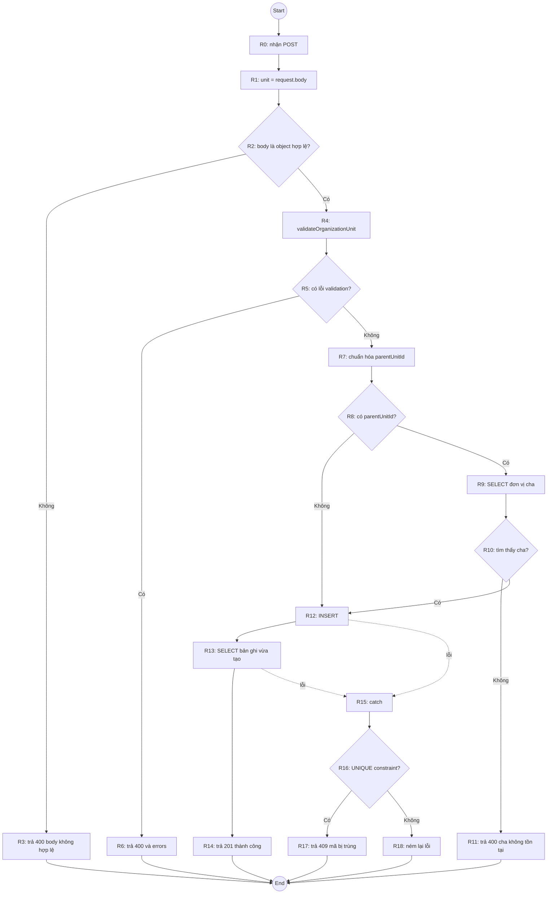
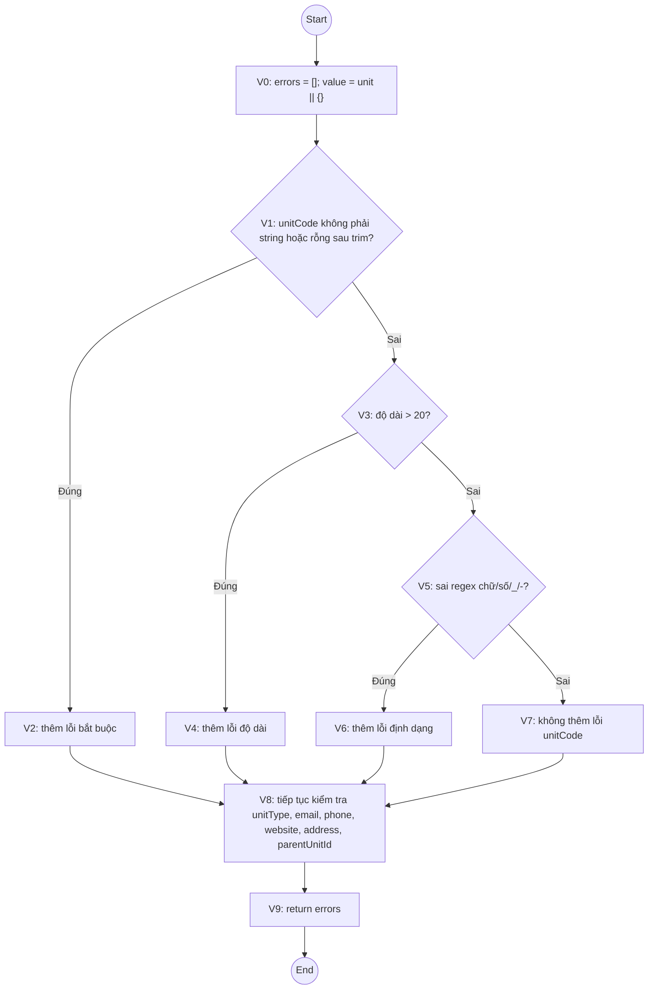

# Kiểm thử hộp trắng: Thêm đơn vị tổ chức

## 1. Phạm vi và cơ sở phân tích

Tài liệu phân tích luồng `POST /api/organization-units` để tạo đơn vị tổ chức, gồm:

- Kiểm tra body của request.
- Kiểm tra các trường bắt buộc và tùy chọn.
- Kiểm tra đơn vị cha (nếu có).
- Ghi dữ liệu vào SQLite, đọc lại bản ghi vừa tạo và trả kết quả.
- Xử lý mã đơn vị bị trùng.

Phân tích dựa trên implementation hiện tại:

- [router.js](../src/organization-unit/router.js): điều khiển request, truy vấn và ghi SQLite.
- [validation.js](../src/organization-unit/validation.js): kiểm tra dữ liệu đầu vào.
- [organization-unit.test.js](../test/organization-unit.test.js): các kiểm thử tích hợp và kiểm thử hàm validation sẵn có.

Phạm vi này không bao gồm giao diện nhập liệu. Việc mở, đóng hoặc hủy form không tạo bản ghi ở API nếu client không gửi request POST.

### Quy ước

- **C1 (phủ câu lệnh):** mỗi câu lệnh/khối xử lý trong đơn vị kiểm thử được thực thi ít nhất một lần.
- **C2 (phủ nhánh):** mỗi kết quả đúng và sai của từng quyết định được thực thi ít nhất một lần.
- Các nhánh `else if` được xem là các quyết định riêng. Với điều kiện ghép dùng `||`/`&&`, C2 chỉ yêu cầu phủ kết quả của quyết định; phủ từng điều kiện con cần tiêu chí mạnh hơn (ví dụ C3 theo giáo trình).
- Đường đi của request được ghi theo các nút `R` (router). Các quyết định validation được ghi theo `V`.
- Trong các bảng, `—` nghĩa là không áp dụng hoặc không có giá trị.

## 2. Kiểm thử dòng điều khiển (*control flow testing*)

### 2.1 Luồng điều khiển của endpoint

Các nút dưới đây là các khối lệnh có cùng luồng điều khiển; `R2`, `R5`, `R8`, `R10` và `R16` là các nút quyết định.

| Nút | Khối lệnh |
|:---:|---|
| R0 | Bắt đầu xử lý request POST |
| R1 | Gán `unit = request.body` |
| R2 | Kiểm tra body là object hợp lệ, không phải `null` hoặc array |
| R3 | Trả `400` với lỗi body không hợp lệ |
| R4 | Gọi `validateOrganizationUnit(unit)` |
| R5 | Kiểm tra `errors.length > 0` |
| R6 | Trả `400` cùng danh sách lỗi validation |
| R7 | Chuẩn hóa `parentUnitId`: `undefined`/`null` thành `null`, trường hợp khác chuyển sang `Number` |
| R8 | Kiểm tra `parentUnitId !== null` |
| R9 | Truy vấn đơn vị cha theo ID |
| R10 | Kiểm tra truy vấn có trả về đơn vị cha không |
| R11 | Trả `400` nếu đơn vị cha không tồn tại |
| R12 | Thực hiện lệnh `INSERT` |
| R13 | Đọc lại đơn vị vừa tạo theo `lastInsertRowid` |
| R14 | Trả `201` và dữ liệu đơn vị vừa đọc |
| R15 | Bắt lỗi trong khối ghi/đọc SQLite |
| R16 | Kiểm tra `error.code === 'SQLITE_CONSTRAINT_UNIQUE'` |
| R17 | Trả `409` nếu mã đơn vị bị trùng |
| R18 | Ném lại lỗi khác để Express xử lý |



Nhánh `R12` và `R13` khi phát sinh lỗi đi vào `catch`. Nhánh `R18` không tạo response thành công giả; lỗi được chuyển tiếp cho error handler của Express.

### 2.2 Bộ ca kiểm thử dòng điều khiển

Các ca sau là bộ ca đề xuất để phủ các quyết định chính của endpoint. Một ca có thể phủ nhiều nhánh/nút.

| ID | Dữ liệu/thiết lập | Đường đi chính | Kết quả mong đợi | Nhánh được phủ |
|---|---|---|---|---|
| WB-CF01 | Body là `null` hoặc `[]` | `R0-R1-R2-R3` | `400`, `errors[0].field = "body"`; không gọi validation/DB | `R2` sai |
| WB-CF02 | Body object `{}` | `R0-R1-R2-R4-R5-R6` | `400`, có lỗi cho các trường bắt buộc; không ghi DB | `R2` đúng, `R5` có lỗi |
| WB-CF03 | Đơn vị hợp lệ, không gửi `parentUnitId`, mã mới | `R0-R1-R2-R4-R5-R7-R8-R12-R13-R14` | `201`, parent là `null`, bản ghi được lưu và đọc lại | `R5` không lỗi, `R8` không có cha |
| WB-CF04 | Đơn vị hợp lệ, `parentUnitId` trỏ tới bản ghi cha đã tồn tại | `R0-R1-R2-R4-R5-R7-R8-R9-R10-R12-R13-R14` | `201`, ID cha được lưu và trả về | `R8` có cha, `R10` tìm thấy |
| WB-CF05 | Đơn vị hợp lệ, `parentUnitId` là số nguyên dương nhưng không tồn tại | `R0-R1-R2-R4-R5-R7-R8-R9-R10-R11` | `400`, trường `parentUnitId` báo cha không tồn tại; không INSERT | `R10` không tìm thấy |
| WB-CF06 | Mã đơn vị hợp lệ về định dạng nhưng đã tồn tại | Đi vào `R12`, lỗi UNIQUE, sau đó `R15-R16-R17` | `409`, thông báo mã đơn vị đã tồn tại | `R16` là UNIQUE |
| WB-CF07 | Dùng database giả lập để `run()` hoặc truy vấn đọc lại ném lỗi có `code` khác UNIQUE | Đi vào `R12`/`R13`, lỗi `R15-R16-R18` | Lỗi được ném lại/Express xử lý; không trả `201` hoặc `409` | `R16` không phải UNIQUE |

`WB-CF07` là kiểm thử cấp router với database stub/mock, không phải ca cần gây lỗi SQLite thật. Cách này kiểm tra nhánh lỗi tổng quát mà không làm hỏng dữ liệu hoặc phụ thuộc tình trạng môi trường.

### 2.3 Bao phủ C1 và C2

#### Phủ câu lệnh C1

Một tập tối thiểu ở mức luồng router để đi qua các nhóm câu lệnh là `WB-CF01` đến `WB-CF07`:

- `WB-CF01` chạy response lỗi body.
- `WB-CF02` chạy validation và response lỗi validation.
- `WB-CF03` chạy chuẩn hóa parent mặc định, INSERT, SELECT và response thành công.
- `WB-CF04` chạy truy vấn parent có kết quả.
- `WB-CF05` chạy response parent không tồn tại.
- `WB-CF06` chạy response lỗi UNIQUE.
- `WB-CF07` chạy lệnh ném lại lỗi không phải UNIQUE.

Đây là C1 cho các khối xử lý của router; các câu lệnh nằm trong từng nhánh validation cần được bao phủ thêm bằng các ca `WB-VAL` ở mục 2.4.

#### Phủ nhánh C2 của router

| Quyết định | Nhánh đúng | Nhánh sai | Ca phủ |
|---|---|---|---|
| `R2`: body không hợp lệ? | Body `null`/array | Body object | `WB-CF01` / `WB-CF02` |
| `R5`: có lỗi validation? | Có lỗi | Không có lỗi | `WB-CF02` / `WB-CF03` |
| `R8`: có `parentUnitId`? | Có ID cha | Không có ID cha | `WB-CF04` hoặc `WB-CF05` / `WB-CF03` |
| `R10`: tìm thấy parent? | Tìm thấy | Không tìm thấy | `WB-CF04` / `WB-CF05` |
| `R16`: UNIQUE constraint? | UNIQUE | Lỗi khác UNIQUE | `WB-CF06` / `WB-CF07` |

Điều kiện ghép ở `R2` có thể short-circuit; bộ ca trên phủ kết quả quyết định. Nếu môn học yêu cầu phủ từng điều kiện con, bổ sung body primitive (ví dụ chuỗi JSON) và xác minh riêng các nhánh `!unit`, `typeof unit !== 'object'`, `Array.isArray(unit)`.

### 2.4 Các quyết định validation và ca phủ nhánh

`validateOrganizationUnit` kiểm tra từng trường độc lập và có thể trả về nhiều lỗi trong một lần gọi. Vì vậy, kiểm thử validation trực tiếp giúp định vị nhánh chính xác; kiểm thử API bổ sung xác nhận lỗi chặn thao tác ghi.

| Quyết định/nhánh | Ca dữ liệu gợi ý | Kết quả mong đợi |
|---|---|---|
| `unitName`: không phải chuỗi hoặc rỗng sau `trim()` | `unitName: ""` hoặc `" \t "` | Lỗi bắt buộc: “Vui lòng nhập tên đơn vị” |
| `unitName`: chuỗi có ký tự điều khiển | `"Tên\nđơn vị"` | Lỗi định dạng |
| `unitName`: vượt quá 100 ký tự | 101 ký tự | Lỗi giới hạn 100 |
| `unitName`: hợp lệ ở biên | 100 ký tự | Không có lỗi `unitName` |
| `unitCode`: không phải chuỗi hoặc rỗng sau `trim()` | `unitCode: ""` | Lỗi bắt buộc |
| `unitCode`: vượt quá 20 ký tự | 21 ký tự | Lỗi giới hạn 20 |
| `unitCode`: ký tự ngoài chữ/số/`_`/`-` | `"TCCB.001"` | Lỗi định dạng |
| `unitCode`: hợp lệ ở biên | `"A"` + 19 ký tự số | Không có lỗi `unitCode` |
| `unitType`: không phải chuỗi hoặc rỗng sau `trim()` | `unitType: ""` | Lỗi bắt buộc |
| `unitType`: không thuộc tập cho phép | `"Trung tâm"` | Lỗi định dạng |
| `unitType`: thuộc tập cho phép | `"Khoa"` (có thể lặp với ba giá trị còn lại) | Không có lỗi `unitType` |
| `email`: không phải chuỗi hoặc rỗng sau `trim()` | `email: ""` | Lỗi bắt buộc |
| `email`: vượt quá 100 ký tự | 101 ký tự | Lỗi giới hạn 100 |
| `email`: có khoảng trắng hoặc sai biểu thức email | `"bad email"` và `"khong-phai-email"` | Lỗi định dạng |
| `email`: hợp lệ ở biên | Email dài 100 ký tự, không khoảng trắng | Không có lỗi `email` |
| `phone`: không phải chuỗi hoặc rỗng sau `trim()` | `phone: ""` | Lỗi bắt buộc |
| `phone`: sai mẫu `0` + 9 chữ số | `"091234567"` hoặc `"091234567A"` | Lỗi định dạng |
| `phone`: đúng mẫu | `"0912345678"` | Không có lỗi `phone` |
| `website`: bỏ qua kiểm tra tùy chọn | Không có thuộc tính hoặc `website: ""` | Không có lỗi `website` |
| `website`: không phải chuỗi, chỉ có whitespace hoặc chứa whitespace | `website: 42`, `"   "`, `"https://a.co/a b"` | Lỗi định dạng |
| `website`: vượt quá 2048 ký tự | 2049 ký tự | Lỗi giới hạn 2048 |
| `website`: URL không hợp lệ hoặc giao thức không phải HTTP(S) | `"abc"` hoặc `"ftp://example.com"` | Lỗi định dạng; URL sai cú pháp đi qua `catch` trong `isHttpUrl` |
| `website`: HTTP/HTTPS hợp lệ ở biên | URL dài 2048 ký tự, hostname hợp lệ | Không có lỗi `website` |
| `address`: bỏ qua kiểm tra tùy chọn | Không có thuộc tính hoặc `address: ""` | Không có lỗi `address` |
| `address`: không phải chuỗi hoặc chỉ whitespace | `address: 42` hoặc `" "` | Lỗi định dạng |
| `address`: vượt quá 200 ký tự | 201 ký tự | Lỗi giới hạn 200 |
| `address`: hợp lệ ở biên | 200 ký tự | Không có lỗi `address` |
| `parentUnitId`: bỏ qua kiểm tra tùy chọn | Không có thuộc tính hoặc `null` | Không có lỗi validation |
| `parentUnitId`: giá trị không phải số nguyên dương sau chuyển đổi | `0`, `-1`, `1.5`, `"abc"` | Lỗi “Đơn vị cha không hợp lệ” |
| `parentUnitId`: số nguyên dương | `1` hoặc `"1"` | Qua validation; router tiếp tục kiểm tra ID có tồn tại trong DB |

Các ca biên và nhiều ca tương ứng đã có trong [organization-unit.test.js](../test/organization-unit.test.js), gồm các nhóm TC09–TC95. Khi bổ sung test, nên dùng mã WB riêng nếu ca mới không thuộc các TC hiện có.

## 3. Kiểm thử dòng dữ liệu (*data flow testing*)

### 3.1 Ký hiệu và phạm vi biến

- **def**: điểm gán/định nghĩa giá trị.
- **c-use**: sử dụng để tính toán, chuẩn hóa, tạo câu lệnh hoặc phản hồi.
- **p-use**: sử dụng trong điều kiện rẽ nhánh.
- **DU path**: đường đi từ một def tới một use tương ứng mà không có def mới của biến đó ở giữa (def-clear path).

Các tham số của request (`request.body`) là dữ liệu đầu vào đã được định nghĩa bên ngoài hàm. Bảng dưới theo dõi các biến cục bộ trọng yếu trong router và validation; không liệt kê mọi thuộc tính trong object lỗi vì các thuộc tính đó chỉ cấu thành phản hồi.

### 3.2 Bảng def/use của router

| Biến | Definition (def) | c-use | p-use | Ý nghĩa kiểm thử |
|---|---|---|---|---|
| `unit` | Gán từ `request.body` | Truyền vào validation; đọc các trường để chuẩn hóa và INSERT | Kiểm tra `!unit`, kiểu object và array | Body sai định dạng phải dừng trước validation/DB; body hợp lệ đi tiếp |
| `errors` | Kết quả `validateOrganizationUnit(unit)` | Đưa toàn bộ lỗi vào response `400` | `errors.length > 0` | Def phải còn nguyên đến quyết định; khi có lỗi không được chạy INSERT |
| `parentUnitId` | Chuẩn hóa từ `unit.parentUnitId` thành `null` hoặc số | Tham số truy vấn parent và cột `parent_unit_id` khi INSERT | `parentUnitId !== null` | Ca không cha đi thẳng tới INSERT; ca có cha phải qua SELECT |
| `parent` | Kết quả của `SELECT id ...` | Không có c-use nghiệp vụ khác | `!parent` | Kết quả truy vấn điều khiển nhánh 400 hoặc cho phép INSERT |
| `result` | Giá trị trả về từ `INSERT ... .run()` | Đọc `result.lastInsertRowid` cho truy vấn đọc lại | — | ID vừa tạo phải là ID được dùng để đọc lại đúng bản ghi |
| `createdUnit` | Kết quả truy vấn SELECT sau INSERT | Đưa vào JSON response `201` | — | Response thành công phải dựa trên dữ liệu đã đọc từ DB |
| `error` | Tham số lỗi được tạo khi vào `catch` | — | `error.code === 'SQLITE_CONSTRAINT_UNIQUE'` | Chỉ lỗi UNIQUE được ánh xạ thành 409; lỗi khác phải được ném lại |

### 3.3 Bảng def/use của validation và helper

Các giá trị `value.<field>` được định nghĩa từ object đầu vào. `value` là alias cho `unit || {}`; alias này không sao chép các trường, nên use của `value.<field>` chính là use dữ liệu request tương ứng.

| Biến/dữ liệu | Definition | c-use | p-use |
|---|---|---|---|
| `unit` (tham số validator) | Tham số hàm | `unit || {}` | Toán hạng của `unit || {}` |
| `value` | `const value = unit || {}` | Đọc các trường và truyền giá trị cho `characterCount`/`isHttpUrl` | Dùng trong tất cả quyết định validation theo trường |
| `errors` | `const errors = []` | Trả về cuối hàm; router đọc danh sách lỗi | — |
| `value.unitName` | Input request | `trim()`, đếm ký tự | Kiểm tra kiểu, rỗng, ký tự điều khiển, độ dài |
| `value.unitCode` | Input request | `trim()`, đếm ký tự, regex | Kiểm tra kiểu, rỗng, độ dài, định dạng |
| `value.unitType` | Input request | `trim()`, tra `UNIT_TYPES` | Kiểm tra kiểu, rỗng, loại cho phép |
| `value.email` | Input request | `trim()`, đếm ký tự, regex | Kiểm tra kiểu, rỗng, độ dài, định dạng |
| `value.phone` | Input request | `trim()`, regex | Kiểm tra kiểu, rỗng, định dạng |
| `value.website` | Input request | `trim()`, đếm ký tự, gọi `isHttpUrl` | Kiểm tra có được cung cấp, kiểu/whitespace, độ dài, URL |
| `value.address` | Input request | `trim()`, đếm ký tự | Kiểm tra có được cung cấp, kiểu/rỗng, độ dài |
| `value.parentUnitId` | Input request | `Number(...)` | Kiểm tra trường có được cung cấp, số nguyên và lớn hơn 0 |
| `url` trong `isHttpUrl` | Kết quả `new URL(value)` | Đọc `protocol`, `hostname` | Điều kiện kiểm tra HTTP(S) và hostname |
| Giá trị trả về `isHttpUrl` | Kết quả điều kiện trong `try` hoặc `false` khi `new URL` ném lỗi | Được dùng bởi validator | Quyết định URL có hợp lệ hay không |

Mỗi nhánh lỗi validation thêm một phần tử vào `errors`; việc trả về cuối hàm là use của biến này. Đây là thiết kế cho phép báo đồng thời lỗi ở nhiều trường. Router chỉ xét `errors.length`, không bỏ qua các lỗi sau lỗi đầu tiên.

### 3.4 DU-path tiêu biểu

| Biến | Def → use | DU-path/điều kiện def-clear | Ca kiểm thử minh họa |
|---|---|---|---|
| `unit` | Gán từ body → kiểm tra body | `R1 → R2` | `WB-CF01`, `WB-CF02` |
| `unit` | Gán từ body → gọi validator/đọc trường INSERT | `R1 → R2(đúng) → R4` và nhánh success tiếp theo | `WB-CF03` |
| `errors` | Validator tạo danh sách → quyết định chặn request | `R4 → R5` | `WB-CF02` |
| `errors` | Validator trả danh sách rỗng → tiếp tục chuẩn hóa parent | `R4 → R5(sai) → R7` | `WB-CF03` |
| `parentUnitId` | Chuẩn hóa thành `null` → kiểm tra có cha | `R7 → R8` | `WB-CF03` |
| `parentUnitId` | Chuẩn hóa thành số → truy vấn parent và dùng làm khóa INSERT | `R7 → R8(có cha) → R9 → R10(tìm thấy) → R12` | `WB-CF04` |
| `parent` | SELECT trả về object hoặc `undefined` → quyết định `!parent` | `R9 → R10` | `WB-CF04`, `WB-CF05` |
| `result` | INSERT trả `result` → lấy `lastInsertRowid` | `R12 → R13` | `WB-CF03` |
| `createdUnit` | SELECT trả bản ghi → đưa vào response | `R13 → R14` | `WB-CF03` |
| `error` | Vào `catch` → kiểm tra mã lỗi | `R12/R13 (lỗi) → R15 → R16` | `WB-CF06`, `WB-CF07` |
| `value.unitName` | Input field → trim/kiểm tra required/độ dài | Đầu vào → quyết định ở validator → nhánh lỗi hoặc tiếp tục | TC09, TC14, TC15 |
| `value.unitCode` | Input field → regex → đưa vào INSERT nếu hợp lệ | Đầu vào → validation → `R12` | TC23/TC28; `WB-CF06` cho trùng UNIQUE |
| `value.website` | Input field → kiểm tra optional/URL → INSERT hoặc `null` | Đầu vào → validation → `R12` | TC64/TC65/TC69; TC95 xác nhận giá trị rỗng thành `null` |

### 3.5 Kiểm tra tính toàn vẹn dữ liệu theo dòng dữ liệu

Các assertion sau xác minh dữ liệu đi từ definition đến use đúng cách:

1. **Validation thất bại không ghi dữ liệu:** gửi một body có nhiều trường sai; kỳ vọng `400`, response có lỗi của từng trường và số dòng trong `organization_units` không tăng. Bộ test hiện có kiểm tra tình huống này trong TC94.
2. **Giá trị parent được truyền nhất quán:** tạo parent, tạo child với ID của parent; kỳ vọng cột `parent_unit_id` và `parentUnitId` trong response bằng ID parent. Luồng này có trong TC01–TC03.
3. **Giá trị optional rỗng được chuẩn hóa đúng:** bỏ trống `website`/`address`; kỳ vọng INSERT lưu `NULL`, không phải chuỗi rỗng. Luồng này có trong TC05–TC07 và TC95.
4. **ID INSERT nối đúng tới SELECT:** sau khi tạo thành công, response phải chứa bản ghi có các giá trị đã gửi (sau các phép chuẩn hóa trong router) và trạng thái mặc định do schema cấp. Luồng thành công được kiểm tra trong TC01–TC04.
5. **Lỗi UNIQUE không tạo bản ghi thứ hai:** gửi lại cùng mã; kỳ vọng `409` và tổng số bản ghi cho mã đó vẫn là một. Luồng này có trong TC18 và TC105.
6. **Def lỗi được dùng để phân loại đúng:** UNIQUE trả `409`; lỗi database khác phải được ném lại cho Express, không được biến thành thông báo trùng mã. Kiểm tra nhánh lỗi khác UNIQUE bằng database stub như `WB-CF07`.

## 4. Đối chiếu với bộ kiểm thử hiện có

| Mục tiêu hộp trắng | Kiểm thử hiện có |
|---|---|
| Tạo thành công, dữ liệu lưu và đọc lại, parent tồn tại | TC01–TC04 |
| Các trường tùy chọn vắng mặt/rỗng | TC05–TC07, TC64, TC77, TC95 |
| Required, định dạng, ký tự điều khiển và biên độ dài | TC09–TC84 |
| Kiểm tra tất cả trường cùng lúc và không ghi khi invalid | TC85–TC95 |
| Parent hợp lệ, duplicate code, nhiều lần submit | TC01–TC03, TC18, TC105 |
| Không tạo draft hoặc row khi submit invalid | TC96–TC104 |
| Body sai hình dạng, parent ID không tồn tại, database error khác UNIQUE | Bổ sung các ca `WB-CF01`, `WB-CF05`, `WB-CF07` nếu chưa có test tương ứng |

Các TC hiện có xác nhận nhiều nhánh validation, nhưng không nên xem mọi nhánh của router đã được phủ chỉ vì API có một ca tạo thành công và một ca validation thất bại. Đặc biệt cần có ca parent không tồn tại và nhánh ném lại lỗi không phải UNIQUE để hoàn tất C2 của router.

## 5. Kết luận

Để báo cáo đạt **C2 cho router**, cần thực thi tối thiểu các nhánh ở bảng 2.3; riêng nhánh lỗi không phải UNIQUE cần database stub/mock. Để bao phủ các khối validation, chạy các ca biên ở bảng 2.4 kết hợp với bộ test hiện có. Phân tích dòng dữ liệu tập trung bảo đảm các giá trị `unit`, `errors`, `parentUnitId`, `result`, `createdUnit` và `error` đi từ definition tới đúng use, đồng thời lỗi validation hoặc lỗi parent không tồn tại không thể đi tới lệnh INSERT.

## 6. Bài giải theo các ví dụ và tiêu chí trong tài liệu lý thuyết

Phần này trình bày lại bài toán theo đúng cách làm trong [Kythuatkiemthuhoptrang.md](../Kythuatkiemthuhoptrang.md): đánh số đỉnh, liệt kê đường đi, điều kiện đầu vào, đầu ra mong đợi; tiếp theo đánh dấu `def`, `c-use`, `p-use`, def-clear path và các độ đo dòng dữ liệu.

### 6.1 CFG của hàm validation

Do `validateOrganizationUnit` kiểm tra từng trường tuần tự, mỗi trường có một nhánh con. Sơ đồ dưới đây biểu diễn cấu trúc chung cho trường bắt buộc `unitCode`; các trường khác theo cùng kiểu rẽ nhánh nhưng có số lượng quyết định khác nhau.



Với các input khác nhau, đường đi của riêng khối `unitCode` là:

| ID | `unitCode` | Đường đi | Kết quả ở trường `unitCode` |
|---|---|---|---|
| WB-VAL-CODE01 | `""` | `V1-Đúng → V2` | Required error |
| WB-VAL-CODE02 | `"A".repeat(21)` | `V1-Sai → V3-Đúng → V4` | Length error |
| WB-VAL-CODE03 | `"TCCB.001"` | `V1-Sai → V3-Sai → V5-Đúng → V6` | Format error |
| WB-VAL-CODE04 | `"TCCB_001"` | `V1-Sai → V3-Sai → V5-Sai → V7` | Không có lỗi trường này |

Đường đi tổng thể tiếp tục qua các trường phía sau và trả về `errors`; một lỗi ở trường hiện tại không kết thúc hàm. Vì vậy, một request có nhiều trường sai phải chứa nhiều lỗi, không chỉ lỗi đầu tiên.

### 6.2 C1, C2 và C3: cách chọn bộ dữ liệu

#### C1 – phủ câu lệnh

Đối với router, tập `WB-CF01`–`WB-CF07` ở mục 2.2 đi qua các khối response lỗi body, response lỗi validation, kiểm tra parent, lưu thành công, lỗi UNIQUE và lỗi khác UNIQUE.

Đối với validator, phải chạy ít nhất một input cho mỗi loại khối lệnh có thể thực thi:

- Thêm lỗi required, lỗi định dạng và lỗi độ dài.
- Không thêm lỗi cho dữ liệu hợp lệ.
- Bỏ qua kiểm tra trường tùy chọn khi vắng mặt/rỗng.
- Gọi helper đếm ký tự và helper kiểm tra URL; helper URL cần cả URL hợp lệ và URL làm `new URL()` ném lỗi.
- Trả danh sách rỗng và danh sách có lỗi.

Một ca có thể đi qua nhiều khối, nhưng không thể thay ca thành công bằng một ca lỗi tổng hợp: khi field sai, chuỗi `else if` bỏ qua các nhánh kiểm tra kế tiếp của chính field đó.

#### C2 – phủ nhánh

Đối với endpoint, sử dụng bảng C2 ở mục 2.3. Đối với validator, mỗi quyết định phải có cả kết quả đúng và sai; ví dụ `unitCode` cần đủ bốn ca `WB-VAL-CODE01`–`WB-VAL-CODE04` để đi qua required, length, regex và nhánh hợp lệ.

Với trường optional `website`, cần ít nhất:

| ID | Input | Nhánh chính |
|---|---|---|
| WB-VAL-WEB01 | Field không có hoặc `""` | Điều kiện ngoài `value.website !== undefined && value.website !== ''` là sai |
| WB-VAL-WEB02 | `"   "` | Có website; nhánh kiểu/rỗng/whitespace sai định dạng |
| WB-VAL-WEB03 | `"x".repeat(2049)` | Qua kiểm tra kiểu/whitespace; nhánh quá độ dài |
| WB-VAL-WEB04 | `"ftp://example.com"` | Qua kiểu/whitespace/độ dài; URL không thỏa HTTP(S) |
| WB-VAL-WEB05 | `"https://example.com"` | Nhánh URL hợp lệ |
| WB-VAL-WEB06 | `"not a URL"` | Helper `isHttpUrl` bắt lỗi từ `new URL()` và trả `false` |

#### C3 – phủ điều kiện con

Theo định nghĩa trong tài liệu lý thuyết, mỗi điều kiện con của một quyết định ghép cần nhận cả giá trị đúng và sai. Các bộ sau tách riêng một số điều kiện ghép quan trọng; chúng bổ sung cho C2, không thay thế toàn bộ bảng validation.

| Quyết định ghép | Ca đầu vào | Điều kiện con được kích hoạt |
|---|---|---|
| Router: `!unit || typeof unit !== 'object' || Array.isArray(unit)` | body `null` | `!unit` đúng (short-circuit) |
|  | body `"text"` | `!unit` sai; sai kiểu object đúng |
|  | body `[]` | hai điều kiện đầu sai; `Array.isArray` đúng |
|  | body object hợp lệ về dạng | cả ba điều kiện sai |
| Website: `typeof !== 'string' || trim()==='' || /\s/.test(...)` | `website: 42` | điều kiện kiểu sai chuỗi đúng |
|  | `website: "   "` | kiểu hợp lệ; `trim()===''` đúng |
|  | `website: "https://a.co/a b"` | hai điều kiện đầu sai; có whitespace đúng |
|  | `website: "https://example.com"` | cả ba điều kiện sai |
| Parent validation: có cung cấp, khác `null`, và (`không nguyên` hoặc `<= 0`) | bỏ thuộc tính | điều kiện “đã cung cấp” sai |
|  | `parentUnitId: null` | có cung cấp theo `!== undefined`, nhưng `!== null` sai |
|  | `parentUnitId: 1` | hai điều kiện đầu đúng; `Number.isInteger` đúng và `<= 0` sai |
|  | `parentUnitId: 0` | có cung cấp, khác null; điều kiện `<= 0` đúng |
| Router parent: `undefined || null` khi chuẩn hóa | bỏ thuộc tính | vế `=== undefined` đúng |
|  | `parentUnitId: null` | vế đầu sai, vế `=== null` đúng |
|  | `parentUnitId: 1` | cả hai vế sai; chạy `Number(...)` |

Do short-circuit, không phải mọi nhánh con đều được đánh giá trong một lần chạy. Các input trong bảng được chọn để lần lượt làm lộ từng vế; nếu cần báo cáo C3 chính thức, ghi nhận trạng thái T/F của từng điều kiện con theo từng ca, không chỉ ghi kết quả chung của `if`.

### 6.3 Sinh test path và tính kết quả mong đợi

Giống ví dụ sinh đường đi trong tài liệu lý thuyết, mỗi test path cần gắn với input thực thi được và expected output. Các ca dưới đây là ví dụ đại diện cho đường đi bình thường, lỗi validation, lỗi parent và lỗi UNIQUE.

| ID | Test path | Input/thiết lập | Expected output và trạng thái DB |
|---|---|---|---|
| WB-PATH01 | `R0-R1-R2(T)-R4-R5(F)-R7-R8(F)-R12-R13-R14` | Đơn vị hợp lệ, không parent, code chưa dùng | HTTP `201`; response có đơn vị; DB tăng 1 dòng; `parentUnitId = null` |
| WB-PATH02 | `R0-R1-R2(T)-R4-R5(T)-R6` | Đơn vị hợp lệ nhưng `email: "bad-email"` | HTTP `400`; có lỗi `email`; DB không tăng dòng |
| WB-PATH03 | `R0-R1-R2(T)-R4-R5(F)-R7-R8(T)-R9-R10(T)-R12-R13-R14` | Tạo parent trước, truyền ID parent tồn tại vào request hợp lệ | HTTP `201`; response và DB chứa đúng ID parent |
| WB-PATH04 | `R0-R1-R2(T)-R4-R5(F)-R7-R8(T)-R9-R10(F)-R11` | Parent ID dương nhưng không có trong DB | HTTP `400`; lỗi `parentUnitId`; DB không tăng dòng |
| WB-PATH05 | `...-R12(error)-R15-R16(T)-R17` | Gửi mã đã có trong DB | HTTP `409`; response lỗi mã trùng; không tạo dòng thứ hai |
| WB-PATH06 | `...-R12(error)-R15-R16(F)-R18` | Stub database ném lỗi không phải UNIQUE | Lỗi được ném lại; không có response `201`/`409` giả |

`T`/`F` trong test path là kết quả điều kiện. Ví dụ `WB-PATH01` yêu cầu tất cả field bắt buộc hợp lệ; một input không thỏa validation sẽ kết thúc ở `R6`, không thể phủ được đường đi tới INSERT.

### 6.4 Đồ thị dòng dữ liệu rút gọn của router

Theo lý thuyết, đỉnh biểu diễn def/c-use, còn p-use gắn trên cạnh của quyết định. Bảng này dựng đồ thị rút gọn cho các biến điều khiển quan trọng; các thuộc tính trường như `unit.unitCode` được mô tả riêng ở mục 3.3.

| Nút dữ liệu | Statement/ý nghĩa | `def()` | `c-use()` |
|:---:|---|---|---|
| D0 | Entry/request | `{request.body}` (tham số đầu vào) | `{}` |
| D1 | `unit = request.body` | `{unit}` | `{request.body}` |
| D2 | `errors = validateOrganizationUnit(unit)` | `{errors}` | `{unit}` |
| D3 | `parentUnitId = ...` | `{parentUnitId}` | `{unit.parentUnitId}` |
| D4 | `parent = SELECT ...get(parentUnitId)` | `{parent}` | `{parentUnitId}` |
| D5 | `result = INSERT ...run(...)` | `{result}` | `{parentUnitId, unit fields}` |
| D6 | `createdUnit = SELECT ...get(result.lastInsertRowid)` | `{createdUnit}` | `{result}` |
| D7 | `response.status(201).json(...)` | `{}` | `{createdUnit}` |
| D8 | `error` tại `catch` | `{error}` | `{}` |
| D9 | `throw error` | `{}` | `{error}` |
| D10 | Exit | `{}` | `{}` |

Các p-use chính trên cạnh:

| Cạnh | Predicate use (`p-use`) |
|---|---|
| `D1 → body-invalid-exit` / `D1 → D2` | `unit` trong `!unit || typeof unit !== 'object' || Array.isArray(unit)` |
| `D2 → validation-error-exit` / `D2 → D3` | `errors` trong `errors.length > 0` |
| `D3 → D4` / `D3 → D5` | `parentUnitId` trong `parentUnitId !== null` |
| `D4 → parent-not-found-exit` / `D4 → D5` | `parent` trong `!parent` |
| `D8 → R16(true)` / `D8 → R16(false)` | `error` trong `error.code === 'SQLITE_CONSTRAINT_UNIQUE'` |

Đường đi thành công tiêu biểu:

```text
D0-D1-D2-D3-D5-D6-D7-D10
```

Đường đi thành công có parent:

```text
D0-D1-D2-D3-D4-D5-D6-D7-D10
```

Đường đi parent không tồn tại dừng ngay sau use điều kiện của `parent`:

```text
D0-D1-D2-D3-D4-parent-not-found-exit-D10
```

### 6.5 DU-path và độ đo dòng dữ liệu

Một DU-path phải def-clear đối với biến đang xét. Nếu biến bị định nghĩa lại trên đường đi thì DU-path của definition cũ kết thúc ở definition mới đó; không nối tiếp đến use phía sau như thể definition cũ vẫn còn hiệu lực.

| Biến | Global def → use | Def-clear path / loại use | Test path minh họa |
|---|---|---|---|
| `unit` | `D1 → D2` | `D2` nhận `unit` khi gọi validator; c-use | `WB-PATH01`, `WB-PATH02` |
| `unit` | `D1 → R2` | Điều kiện kiểm tra body; p-use trên cạnh đúng/sai | `WB-CF01`, `WB-CF02` |
| `errors` | `D2 → R5` | `errors.length > 0`; p-use | `WB-PATH01`, `WB-PATH02` |
| `errors` | `D2 → R6` | Serialize danh sách lỗi; c-use trên nhánh có lỗi | `WB-PATH02` |
| `parentUnitId` | `D3 → R8` | So sánh với `null`; p-use | `WB-PATH01`, `WB-PATH03` |
| `parentUnitId` | `D3 → D4` | Là tham số SELECT parent; c-use | `WB-PATH03`, `WB-PATH04` |
| `parentUnitId` | `D3 → D5` | Giá trị ghi vào cột parent; c-use | `WB-PATH01`, `WB-PATH03` |
| `parent` | `D4 → R10` | Kiểm tra `!parent`; p-use | `WB-PATH03`, `WB-PATH04` |
| `result` | `D5 → D6` | `result.lastInsertRowid`; c-use | `WB-PATH01` |
| `createdUnit` | `D6 → D7` | Gắn vào JSON response; c-use | `WB-PATH01` |
| `error` | `D8 → R16` | Đọc `error.code`; p-use | `WB-PATH05`, `WB-PATH06` |
| `error` | `D8 → D9` | Ném lại chính lỗi ban đầu; c-use | `WB-PATH06` |

Từ các DU-path trên, lựa chọn độ đo theo định nghĩa trong tài liệu lý thuyết:

- **All-defs:** với mỗi definition quan trọng, chạy ít nhất một DU-path từ definition tới một use. Bộ `WB-PATH01`–`WB-PATH06` thể hiện definition và use chính của luồng router; riêng `error` yêu cầu cả lỗi UNIQUE lẫn lỗi khác nếu cần kiểm tra hai predicate-use outcome.
- **All-c-uses:** bao phủ các c-use reachable của mỗi definition. Ví dụ, definition `parentUnitId` phải đi tới truy vấn parent khi có parent và tới tham số INSERT; definition `result` phải đi tới truy vấn SELECT; definition `createdUnit` phải đi tới response.
- **All-p-uses:** bao phủ cả cạnh true/false chứa p-use. Các cặp `WB-CF01/02`, `WB-CF02/03`, `WB-CF03/04`, `WB-CF04/05`, `WB-CF06/07` lần lượt phủ hai cạnh của các quyết định router tương ứng.
- **All-uses:** kết hợp các c-use và p-use reachable. Ca thành công đơn lẻ không đủ vì nó không đi qua các use trên nhánh lỗi validation, parent không tồn tại hay catch.

Không yêu cầu All-du-paths vô hạn trên mọi vòng lặp: endpoint này không có vòng lặp nghiệp vụ trong router/validator; vòng lặp nội bộ của `Array.from`/runtime không thuộc đơn vị kiểm thử nghiệp vụ. Với từng biến, chỉ tính các DU-path thực thi được theo đồ thị đã giới hạn trong phạm vi.

### 6.6 Bài tập mẫu áp dụng def/use cho `unitCode`

`unitCode` được lấy từ input, dùng trong validation, sau đó nếu hợp lệ được truyền vào INSERT. Đường dữ liệu thành công là:

```text
request.body.unitCode
    → V: required check
    → V: length check
    → V: format check
    → R12: INSERT unit_code
```

Các điểm cần xác nhận:

1. Giá trị sai required/length/format tạo lỗi và không tới `R12`.
2. Mã hợp lệ tới `R12` và được lưu nguyên dạng (router không gọi `trim()` trên `unitCode`).
3. Mã hợp lệ nhưng trùng vẫn qua validation; UNIQUE constraint là nhánh lỗi ở DB và phải trả `409`.
4. Mã hợp lệ, chưa dùng được lưu thành công; response đọc lại từ DB có cùng `unitCode`.

| Ca | Input `unitCode` | Đường đi | Kết quả mong đợi |
|---|---|---|---|
| WB-DU01 | `""` | Input → V required → lỗi → return errors → router `R6` | `400`; không INSERT |
| WB-DU02 | `"TCCB.001"` | Input → V required pass → length pass → regex fail → router `R6` | `400`; lỗi định dạng; không INSERT |
| WB-DU03 | `"TCCB_001"` chưa tồn tại | Input → các validation pass → `R12` → `R13` → `R14` | `201`; DB/response có `"TCCB_001"` |
| WB-DU04 | `"TCCB_001"` đã tồn tại | Input → các validation pass → `R12` → catch UNIQUE → `R17` | `409`; không có bản ghi thứ hai |

Đây là ví dụ DU thực thi: definition đầu vào được theo dõi qua các predicate-use validation và đến c-use ở INSERT hoặc rẽ sang response lỗi. Các ca WB-DU01–04 tương ứng với hành vi test validation/UNIQUE đã được kiểm tra một phần trong TC17–TC29, TC18 và TC105.

## 7. Kiểm thử đơn vị

Kiểm thử đơn vị của module được đặt tại [organization-unit.unit.test.js](../test/organization-unit.unit.test.js) và chạy bằng:

```bash
node --test test/organization-unit.unit.test.js
```

File này kiểm tra hai đơn vị độc lập:

| Đơn vị | Cách cô lập | Phạm vi |
|---|---|---|
| `validateOrganizationUnit` | Gọi trực tiếp hàm, không khởi tạo server/SQLite | Trường bắt buộc, kiểu dữ liệu, định dạng, giới hạn độ dài, trường tùy chọn, parent ID và URL |
| `createOrganizationUnitRouter` | Gọi router bằng request/response giả và database stub | Body sai, lỗi validation, tạo thành công, parent tồn tại/không tồn tại, UNIQUE và chuyển tiếp lỗi database khác |

Database stub ghi nhận truy vấn/tham số để xác nhận dữ liệu được truyền đúng, gồm chuẩn hóa `parentUnitId`, `unitName.trim()` và các trường optional rỗng thành `null`. Những kiểm thử này không thay thế kiểm thử tích hợp trong [organization-unit.test.js](../test/organization-unit.test.js): kiểm thử tích hợp vẫn cần thiết để xác nhận kết nối SQLite, schema và hành vi toàn bộ API.
